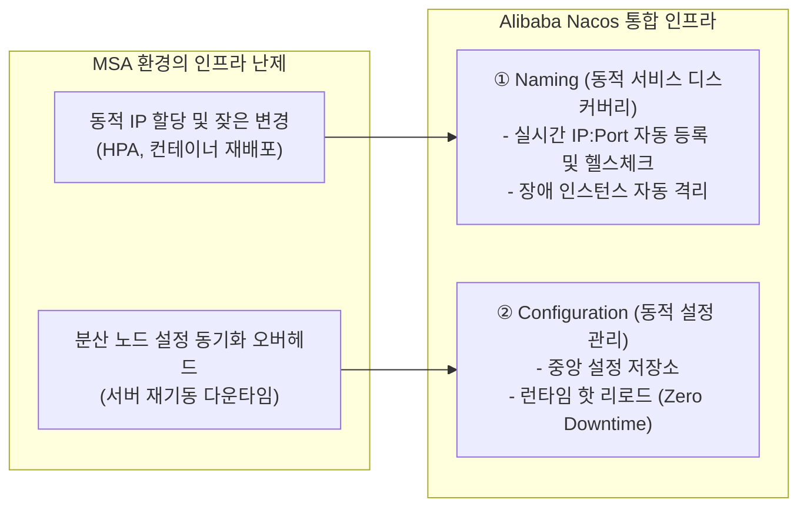
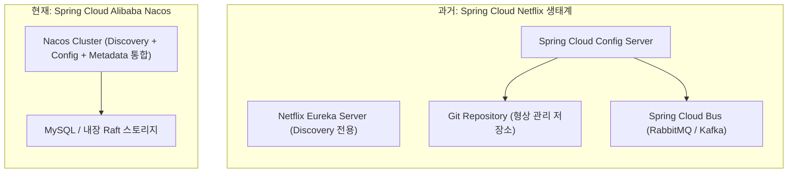
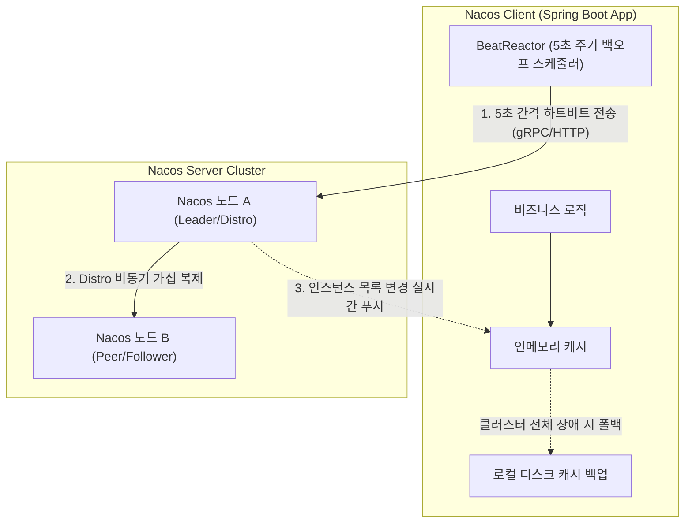
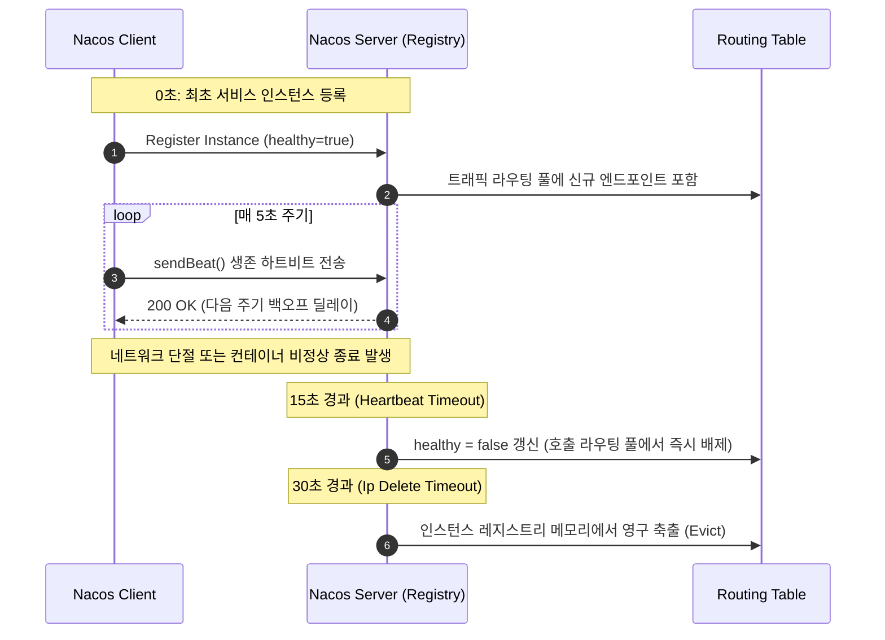
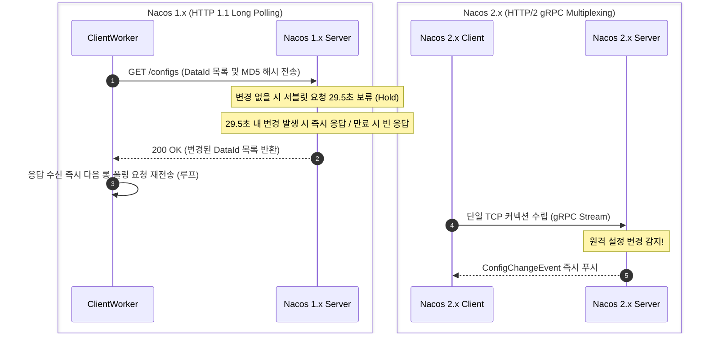
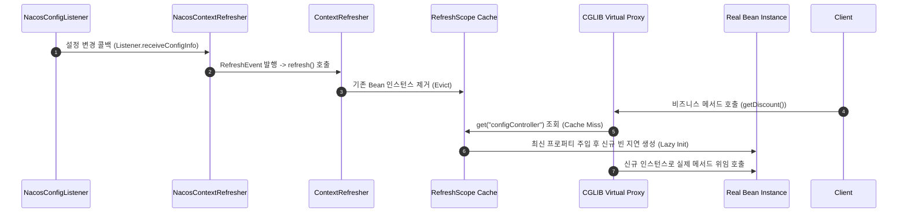
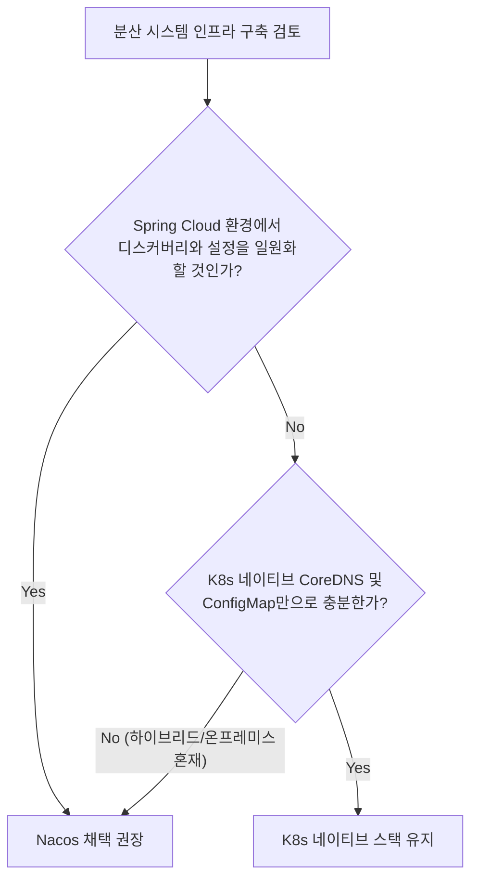

> 마이크로서비스 아키텍처(MSA)를 지탱하는 핵심 인프라인 Nacos의 내부 구조와 서비스 디스커버리, 동적 설정 동기화 메커니즘을 살펴본다.

---

## 1. Nacos 개념과 MSA의 과제

단일 서버에서 모든 기능이 동작하던 모놀리스(Monolith) 환경에서는 인프라 관리가 비교적 단순했다. 컴포넌트 간 호출은 JVM 인메모리 함수 호출로 처리되었고, 애플리케이션 설정은 배포 패키지 내 `application.properties` 하나로 충분했다.

그러나 수십, 수백 개의 독립된 서비스로 잘게 쪼개진 마이크로서비스 아키텍처(MSA)로 전환되면서, 분산 환경 특유의 인프라 관리 과제에 직면하게 되었다.



### 1) 왜 서비스 디스커버리가 필요한가?
* **현실의 문제**: 클라우드와 컨테이너(Docker, Kubernetes) 환경에서 서비스 인스턴스들은 고정된 IP를 갖지 못한다. 트래픽에 따라 오토스케일링(HPA)으로 컨테이너가 수시로 증감하고, 노드 장애나 롤링 업데이트로 파드가 재시작될 때마다 **IP 주소가 무작위로 동적 할당**된다.
* **해결책**: 호출자가 피호출자의 IP를 소스코드나 정적 설정 파일에 하드코딩해 두면 컨테이너가 재부팅되는 즉시 연결이 끊기며 연쇄 장애가 발생한다. 따라서 모든 마이크로서비스의 최신 네트워크 위치를 실시간으로 추적해 주는 **'실시간 주소 레지스트리'**가 필요하며, 이것이 **서비스 디스커버리(Service Discovery)**다.

### 2) 왜 동적 구성 관리가 필요한가?
* **현실의 문제**: 50개의 서비스가 각각 3대씩 총 150개의 컨테이너로 기동 중인 대규모 분산 환경을 가정한다. 긴급 장애 격리를 위해 타임아웃 값을 3초에서 10초로 바꾸거나 기능 플래그를 꺼야 할 수 있다. 이때 150개 컨테이너에 일일이 접속해 설정을 수정하고 프로세스를 재기동하면 큰 서비스 중단과 배포 리스크가 뒤따른다.
* **해결책**: 모든 분산 설정의 원천을 중앙 저장소에 일원화해 변경 이벤트를 실행 중인 인스턴스에 즉시 브로드캐스트해야 한다. 이를 통해 **프로세스 재기동 없이 인메모리에 반영(Hot-Reload)**하는 시스템이 **동적 구성 관리(Dynamic Configuration)**다.

### 3) Nacos: Naming과 Config의 통합
Alibaba가 오픈소스로 공개한 **Nacos(Naming and Configuration Service)**는 두 축을 한곳에 모은 플랫폼이다. 이름 그대로 **'Naming(서비스 디스커버리)'과 'Configuration(동적 설정)'을 단일 런타임으로 통합**한다.

---

## 2. Eureka 대비 아키텍처 강점

과거 Spring Cloud 생태계의 표준이었던 Netflix Eureka 기반 스택과 Nacos의 구조적 차이는 아키텍처 단순성에서 출발한다.



과거 넷플릭스 스택에서는 서비스 검색용 Eureka와 설정 관리용 Config Server, Git 저장소를 각각 따로 두었다. 여기에 설정 변경 이벤트를 전파할 메시지 브로커(Spring Cloud Bus + RabbitMQ/Kafka)까지 합쳐 최소 3\~4개의 독립 클러스터를 유지해야 했다. 반면 Nacos는 단일 클러스터만으로 이 모든 기능을 처리한다.

> [!NOTE]
> **다이어그램 포인트: Eureka가 홀로 떨어져 있는 이유**
> 위 다이어그램에서 Eureka(`E1`)와 Config 스택(`E2~E4`) 사이에 연결선이 없는 것은 의도된 표현이다. 과거 넷플릭스 스택에서는 서비스 검색 인프라와 설정 관리 인프라가 데이터를 공유하지 않고 완전히 분리된 독립 시스템으로 동작했다. 따라서 클라이언트 애플리케이션도 두 인프라에 각각 따로 접속해야 했다.

### 핵심 아키텍처 및 CAP 모델 비교

| 비교 항목 | Netflix Eureka | Alibaba Nacos |
|---|---|---|
| **기능 범위** | 서비스 디스커버리 전용 (단일 목적) | 서비스 디스커버리 + 동적 구성 관리(Config) 통합 |
| **일관성 모델 (CAP)** | **순수 AP 시스템** (가용성 극대화) | **AP + CP 하이브리드** (인스턴스별 유연한 선택 가능) |
| **통신 프로토콜** | HTTP 주기적 폴링 (기본 30초 주기) | UDP 푸시 (1.x) ➔ **gRPC 양방향 스트리밍 (2.x)** |
| **상태 전파 지연** | 최대 수십 초 (3단계 캐시 계층 경유) | **수 밀리초($ms$) 단위** 실시간 이벤트 스트리밍 |
| **인스턴스 유형** | 임시 인스턴스(Ephemeral)만 지원 | **임시(Ephemeral) / 영구(Persistent)** 모두 지원 |
| **오픈소스 생태계** | Eureka 2.x 오픈소스화 중단 (유지보수 모드) | Apache 2.0 라이선스 기반의 지속적인 유지보수 |

CAP 정리에서 **AP**는 네트워크 단절 상황에서도 응답 가용성(Availability)을 우선하는 모델이고, **CP**는 일관성(Consistency)을 우선하는 모델이다. Eureka는 전형적인 AP 시스템인 반면, Nacos는 서비스 검색에는 AP 모델(Distro)을, 영구 메타데이터에는 **CP 모델(Raft)**을 선택할 수 있게 설계되었다.

---

## 3. 서비스 디스커버리 동작 원리

Nacos의 서비스 디스커버리는 활성 인스턴스의 헬스체크 상태를 실시간 수집하고, 장애 인스턴스를 라우팅 풀에서 즉각 배제하는 파이프라인으로 동작한다.



### 1) Distro(AP)와 Raft(CP) 하이브리드 합의
Nacos는 인스턴스의 생명주기 성격에 따라 서로 다른 분산 합의 알고리즘을 이원화하여 적용한다:

* **임시 인스턴스 (Ephemeral, `ephemeral=true`)**:
  * 컨테이너처럼 언제든 소멸하고 재생성될 수 있는 무상태 서비스에 적용된다 (기본값).
  * Alibaba가 개발한 **Distro 프로토콜(AP)**을 쓴다. 중앙 마스터 없이 각 노드가 자기에게 등록된 인스턴스를 관리하며, 동료 노드들끼리 상태를 주고받는 **가십(Gossip) 프로토콜**로 데이터를 비동기 복제한다. 따라서 노드 절반이 다운되어도 서비스 등록과 조회는 중단되지 않는다.
* **영구 인스턴스 (Persistent, `ephemeral=false`)**:
  * 데이터베이스나 고정된 물리 서버처럼 상태가 보존되어야 하는 인스턴스에 적용된다.
  * 전체 노드 중 **과반수 투표(정족수, Quorum)**의 동의를 얻어야만 쓰기를 확정하는 **Raft 프로토콜(CP)**을 사용해 강력한 일관성으로 상태를 동기화한다.

### 2) 3단계 하트비트 생명주기 타임라인
임시 인스턴스는 클라이언트가 서버로 생존 신호를 능동적으로 전송하는 하트비트 메커니즘으로 생명주기를 갱신한다.



1. **5초 (Heartbeat Interval)**: 클라이언트의 `BeatReactor` 스레드가 5초마다 Nacos 서버로 `beat` 요청을 전송한다.
2. **15초 (Heartbeat Timeout)**: 서버가 15초 동안 하트비트를 받지 못하면 해당 인스턴스의 상태를 **`healthy = false`**로 변경한다. 게이트웨이 및 타 마이크로서비스는 이 시점부터 라우팅 대상에서 해당 인스턴스를 즉시 제외한다.
3. **30초 (Ip Delete Timeout)**: 30초 이상 무응답이 지속되면 인스턴스가 완전히 소멸한 것으로 판단하고 **레지스트리 메모리에서 인스턴스를 영구 삭제(Evict)**한다.

### 3) 3계층 클라이언트 캐시와 장애 격리
Nacos 클라이언트는 서버 클러스터 전체가 다운되는 극단적 장애 상황에서도 서비스 간 통신이 멈추지 않도록 3계층 캐시 구조를 둔다.

1. **1차 힙 메모리 캐시**: Nacos에서 받은 최신 인스턴스 목록을 서비스명 키로 JVM 힙에 상주시켜 $0ms$ 수준으로 즉시 주소를 조회한다.
2. **2차 로컬 디스크 캐시 백업**: 인스턴스 목록이 갱신될 때마다 로컬 파일시스템(`${user.home}/nacos/naming/${namespace}/...`)에 JSON 백업 파일로 기록한다. Nacos 서버 전원이 차단되더라도 이 디스크 백업을 읽어 정상 트래픽 라우팅을 이어간다.
3. **3차 실시간 이벤트 채널**: Nacos 1.x의 UDP 브로드캐스트와 Nacos 2.x의 gRPC 롱커넥션 스트림을 통해 토폴로지 변경 사항을 밀리초 단위로 수신한다.

---

## 4. 동적 설정 관리와 핫 리로드

Nacos 동적 설정은 원격 저장소의 설정 변경을 감지해 실행 중인 애플리케이션에 재기동 없이 즉시 반영하는 메커니즘이다.

### 1) HTTP 롱 폴링에서 gRPC 스트리밍으로의 진화



* **Nacos 1.x (HTTP 롱 폴링)**: 단순 주기적 폴링의 CPU와 네트워크 낭비를 막기 위해 **29.5초 지연 응답(Long Polling Hold)** 방식을 쓴다. 클라이언트는 설정 전문 대신 MD5 해시값만 보내며, 변경이 있으면 즉시 응답하고 없으면 29.5초 대기 후 타임아웃 응답을 돌려준다.
* **Nacos 2.x (gRPC 양방향 스트리밍)**: 반복 HTTP 핸드셰이크를 없애고 단일 TCP 연결 기반의 **HTTP/2 gRPC 멀티플렉싱**을 채택했다. 설정이 바뀌면 서버가 활성 스트림으로 이벤트를 즉시 푸시하므로 전파 지연이 크게 줄고 처리 성능(TPS)이 향상된다.

### 2) @RefreshScope와 CGLIB 가상 프록시 동작 원리
스프링 컨테이너에서 일반적인 싱글톤 빈은 기동 시점에 의존성과 프로퍼티가 고정된다. Spring Cloud Alibaba는 `@RefreshScope`를 통해 실행 중인 빈의 상태를 런타임에 동적으로 교체한다.



* `@RefreshScope`가 선언된 빈은 스프링 컨텍스트에 일반 싱글톤 객체로 등록되지 않고 **CGLIB 가상 프록시(Proxy)**로 감싸진다.
* Nacos 설정이 바뀌면 클라이언트 내부 리스너가 이를 수신하고, Spring Cloud Alibaba의 `NacosContextRefresher`가 스프링 `RefreshEvent`를 발행한다. 이 이벤트를 받은 `ContextRefresher.refresh()`는 환경 설정을 다시 읽고 `RefreshScope` 캐시에서 대상 빈 인스턴스를 제거(Evict)한다.
* 이어서 비즈니스 요청이 들어와 프록시가 빈을 조회하면 캐시 미스가 발생한다. 이때 최신 프로퍼티를 주입받은 **새 인스턴스가 즉석에서 지연 생성(Lazy Initialization)**되어 메서드를 실행한다.

---

## 5. 스프링 연동과 클라이언트 코드

실제 Spring Boot 프로젝트 설정 방식과 Nacos 클라이언트 내부의 핵심 동작 코드를 살펴본다. Nacos Config는 설정 충돌을 막기 위해 세 단계 좌표계로 설정 파일을 격리한다.

| 격리 계층 | 역할 및 구분 기준 | 적용 예시 |
|---|---|---|
| **Namespace** | 가장 큰 단위의 환경 및 테넌트 격리 | `dev`, `staging`, `prod` |
| **Group** | 같은 환경 안에서 서비스군이나 팀별 분류 | `DEFAULT_GROUP`, `ORDER_TEAM` |
| **Data ID** | 개별 애플리케이션의 실제 설정 파일 식별자 | `order-service.yaml` |

### 1) Spring Boot 연동과 설정 바인딩

#### ① Maven 의존성 설정 (`pom.xml`)
```xml
<dependencies>
    <!-- Nacos 서비스 디스커버리 -->
    <dependency>
        <groupId>com.alibaba.cloud</groupId>
        <artifactId>spring-cloud-starter-alibaba-nacos-discovery</artifactId>
    </dependency>
    <!-- Nacos 동적 설정 관리 -->
    <dependency>
        <groupId>com.alibaba.cloud</groupId>
        <artifactId>spring-cloud-starter-alibaba-nacos-config</artifactId>
    </dependency>
</dependencies>
```

#### ② 애플리케이션 설정 (`application.yml` vs `bootstrap.yml`)
Spring Boot 2.4 이후 최신 환경에서는 별도 `bootstrap.yml` 없이 기본 **`application.yml`** 안에서 `spring.config.import`로 Nacos 설정을 가져오는 방식을 권장한다. *(구버전 Spring Cloud나 `bootstrap.yml` 방식을 유지하려면 `spring-cloud-starter-bootstrap` 의존성을 추가해야 한다.)*

```yaml
spring:
  application:
    name: order-service
  config:
    # Spring Boot 2.4+ 표준: 애플리케이션 초기화 단계에서 Nacos 원격 설정 임포트
    import: optional:nacos:order-service.yaml
  cloud:
    nacos:
      discovery:
        server-addr: 10.0.1.10:8848
      config:
        server-addr: 10.0.1.10:8848
        file-extension: yaml
        group: DEFAULT_GROUP
        namespace: prod-namespace-id
```

지정된 `Namespace`와 `Group` 아래에서 클라이언트는 기본적으로 `${spring.application.name}.${file-extension}` 규칙에 따라 **`order-service.yaml`**을 Data ID로 조회한다.

> [!NOTE]
> **코드 발췌 범위: Nacos 1.x 기본 메커니즘**
> 아래 5.2절과 5.3절의 `BeatReactor` 및 HTTP 롱 폴링 기반 `ClientWorker`는 Nacos 1.x 코드베이스에 구현된 원형 메커니즘이다. Nacos 2.x에서는 이 통신을 gRPC 영구 스트림으로 옮겼지만, 서버 부하 기반 주기 조절과 해시 우선 확인 원칙은 동일하다.

### 2) BeatReactor의 탄력적 백오프 스케줄링 분석
* **해결하려는 문제**: 수천 개 인스턴스가 고정 5초 타이머로 일제히 하트비트를 보내면, Nacos 서버에 부하가 몰릴수록 타임아웃과 재시도가 겹쳐 부하가 더 커진다. 또한 매번 인스턴스 전체 메타데이터를 실어 보내면 직렬화와 네트워크 비용도 커진다.
* **Nacos의 해결**: `BeatReactor`는 서버 응답에서 돌려받은 지연 시간(`nextTime`)으로 스스로 다음 실행을 예약한다.

```java
// com.alibaba.nacos.client.naming.beat.BeatReactor.java (Nacos 1.x 기준 발췌)
public class BeatReactor {
    private ScheduledExecutorService executorService;
    private final NamingProxy serverProxy;

    public void addBeatInfo(String serviceName, BeatInfo beatInfo) {
        // 1. 첫 번째 하트비트 작업을 기본 주기(보통 5초) 뒤에 실행하도록 예약한다.
        executorService.schedule(new BeatTask(beatInfo), beatInfo.getPeriod(), TimeUnit.MILLISECONDS);
    }

    class BeatTask implements Runnable {
        BeatInfo beatInfo;

        public BeatTask(BeatInfo beatInfo) {
            this.beatInfo = beatInfo;
        }

        @Override
        public void run() {
            // 2. 종료 표시가 켜진 인스턴스는 즉시 중단해 중복 하트비트를 막는다.
            if (beatInfo.isStopped()) {
                return;
            }
            // 3. lightBeatEnabled가 true면 메타데이터 전문 대신 최소 식별자만 보내 대역폭을 아낀다.
            long nextTime = serverProxy.sendBeat(beatInfo, BeatReactor.this.lightBeatEnabled);
            
            // 4. 서버가 응답으로 내려준 다음 대기 시간(nextTime)을 적용해 스스로 재예약한다.
            executorService.schedule(new BeatTask(beatInfo), nextTime, TimeUnit.MILLISECONDS);
        }
    }
}
```

고정 간격 `scheduleAtFixedRate` 대신 매 실행 끝마다 `nextTime`으로 다음 작업을 예약하기 때문에, 서버 과부하 시 백오프 딜레이를 즉각 반영해 트래픽 폭주를 완화할 수 있다.

### 3) ClientWorker의 2단계 롱 폴링 구현체 분석
* **해결하려는 문제**: 동적 설정이 바뀔 때마다 모든 클라이언트가 수 킬로바이트짜리 YAML 전문을 매번 받아 가면 대역폭 낭비가 크다. 반면 최초 기동 시점까지 29.5초를 기다리면 앱 초기화가 지연된다.
* **Nacos의 해결**: `ClientWorker`는 MD5 해시 목록으로 변경된 키만 먼저 솎아낸 뒤, 해당 설정만 개별 다운로드하고 로컬 캐시와 리스너를 깨운다.

```java
// com.alibaba.nacos.client.config.impl.ClientWorker.java (Nacos 1.x 기준 발췌)
public class ClientWorker {
    class LongPollingRunnable implements Runnable {
        @Override
        public void run() {
            List<CacheData> cacheDatas = getWatchedConfigs();
            
            // 1. 로컬에 감시 중인 모든 설정의 DataId, Group, 현재 MD5 해시를 문자열로 묶는다.
            String checkString = checkUpdateDataIds(cacheDatas);
            
            // 2. Nacos 서버에 29.5초 롱 폴링을 보낸다. (초기 기동 리스트면 즉시 응답해 대기 지연을 없앤다.)
            List<String> changedGroupKeys = checkUpdateConfigStr(checkString, isInitializingCacheList);
            
            // 3. 실제 변경이 확인된 키만 분리해 [dataId, group, tenant] 좌표로 전문을 내려받는다.
            for (String groupKey : changedGroupKeys) {
                String[] key = GroupKey.parseKey(groupKey);
                String content = getServerConfig(key[0], key[1], key[2], 3000L); // 3초 타임아웃
                
                // 4. 캐시 내용과 MD5를 갱신하고, 등록된 Nacos Listener를 호출한다.
                //    (Spring Cloud Alibaba의 NacosContextRefresher가 이 리스너를 받아 RefreshEvent를 발행한다.)
                CacheData cache = cacheMap.get(GroupKey.getKeyTenant(key[0], key[1], key[2]));
                cache.setContent(content);
            }
            
            // 5. 이번 주기 처리가 끝나면 다음 롱 폴링 루프를 바로 예약한다.
            executorService.execute(this);
        }
    }
}
```

이처럼 수십 바이트의 MD5 해시 비교 단계와 실제 전문 다운로드(`getServerConfig`) 단계를 분리해 네트워크 부하를 줄이면서 변경 즉시 스프링 리프레시 흐름까지 연결한다.

---

## 6. 도입 기준과 핵심 요약



### 1) 엔지니어링 의사결정 매트릭스
* **Nacos 도입이 필수적인 경우**:
  * Spring Cloud 기반 MSA 환경에서 Eureka와 Spring Cloud Config의 이원화된 인프라 운영 오버헤드를 단일 플랫폼으로 통합하고자 할 때
  * 온프레미스 베어메탈 서버, VM, 이종 클라우드가 혼재되어 쿠버네티스 CoreDNS만으로는 통합 서비스 레지스트리 구축이 불가능한 하이브리드 환경
  * 결제 임계치, 로깅 레벨, 서킷 브레이커 설정 등을 파드 재배포 없이 수 밀리초 단위로 안전하게 핫 리로드해야 할 때

### 2) 핵심 요약 및 교훈
1. **플랫폼 통합성**: Nacos는 **서비스 디스커버리(Naming)**와 **동적 구성 관리(Configuration)**를 단일 런타임으로 일원화하여 분산 인프라 운영 복잡도를 대폭 낮춘다.
2. **하이브리드 일관성**: 컨테이너 기반 무상태 서비스에는 **Distro(AP)**를 적용하여 가용성을 보장하고, 영구 메타데이터에는 **Raft(CP)**를 적용하여 엄격한 정합성을 유지한다.
3. **단계적 하트비트 정책**: **5초(생존 신호) ➔ 15초(비정상 격리) ➔ 30초(영구 축출)**로 이어지는 엄격한 라이프사이클을 통해 장애 인스턴스로의 트래픽 유입을 실시간 차단한다.
4. **프로토콜 현대화**: HTTP 롱 폴링에서 **gRPC 양방향 멀티플렉싱 스트리밍**으로 전환함으로써 네트워크 대역폭 절약과 수 밀리초 수준의 빠른 설정 전파를 달성했다.
5. **투명한 핫 리로드**: 스프링 프레임워크와의 연동에서 **`@RefreshScope`**의 CGLIB 가상 프록시 및 동적 캐시 무효화 메커니즘을 활용하여, 무중단 상태 변경의 안정성을 보장한다.
