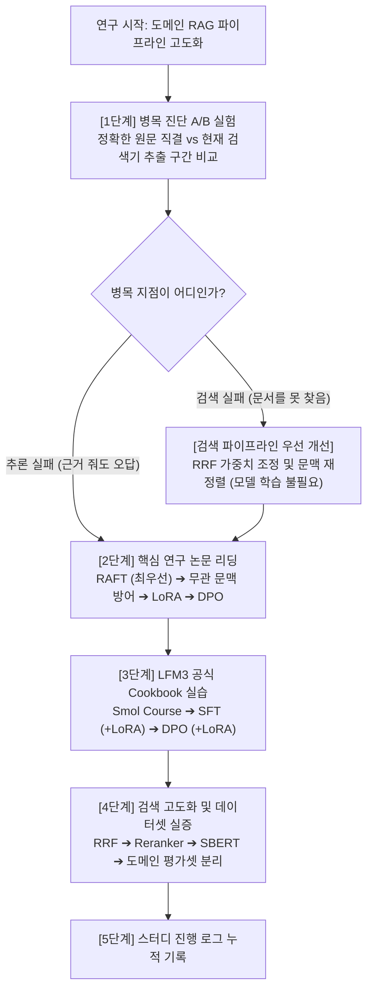
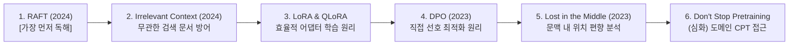

> 도메인 특화 문서 검색과 소형 언어 모델(SLM)의 답변 품질을 개선하기 위해 진행하는 연구 및 실습 로드맵이다.  
> 본 글은 무작정 모델을 파인튜닝하는 대신, **"병목 진단 ➔ 핵심 논문 독해 ➔ 공식 코드 실습 ➔ 검색 개선 및 데이터셋 구축"**으로 이어지는 체계적인 순서로 학습을 진행하며, 새로운 포스트가 발행될 때마다 하단 진행 로그에 링크와 3줄 요약을 누적하여 기록한다.

---

## 1. 학습 로드맵과 실행 순서

"소형 모델이니 무조건 파인튜닝해야 한다"부터 확정할 필요는 없다. 검색 가중치나 문맥 순서를 바꾸는 작업은 모델 학습 없이도 즉시 실험할 수 있기 때문이다.  
따라서 아래의 **4단계 순서도**에 따라, 학습이 필요 없는 영역부터 실험하여 기준선(Baseline)을 확인한 뒤 점진적으로 모델 가중치 학습으로 진입한다.



### 가중치 변경의 6대 종류와 학습 범위
공부를 시작하기 전, 변경 대상에 따라 모델 학습이 필요한지와 불필요한지를 구분하면 우선순위를 명확히 잡을 수 있다.

| 구분 | 바꾸는 대상 | 도메인 질의응답 시스템에서 기대하는 개선 | 학습 필요 여부 |
|---|---|---|:---:|
| **검색 가중치·RRF 조정** | 의미 검색(Vector)과 키워드 검색(BM25) 결합 방식 | 질문 의도에 맞는 자료를 상위 순위로 배치 | ❌ (수식/가중치 튜닝) |
| **재정렬·문맥 구성** | 검색 후보 순서, LLM에 전달할 구간과 분량 | 작은 모델이 읽을 핵심 근거 선별 및 방해 문맥 배제 | ❌ (파이프라인 조정) |
| **임베딩 파인튜닝** | 검색 임베딩 모델의 가중치 | 도메인 전문 용어와 약어를 반영한 검색 벡터 도출 | ⭕ (검색 모델 학습) |
| **SFT (지도 미세조정)** | 답변 생성 언어 모델의 가중치 | 정형화된 JSON 추출, 기술 분석 글 작성 양식 학습 | ⭕ (답변 모델 학습) |
| **DPO (선호 학습)** | 답변 생성 언어 모델의 가중치 | 같은 질문에서 관찰과 가설을 구분한 답변 선호 | ⭕ (답변 모델 학습) |
| **지속 사전학습 (CPT)** | 답변 생성 언어 모델의 가중치 | 전문 분야의 원문 어휘와 문장 분포 적응 | ⭕ (답변 모델 학습) |

- **LoRA와 QLoRA의 위치**: [LoRA(2021)](https://arxiv.org/abs/2106.09685)와 [QLoRA(2023)](https://arxiv.org/abs/2305.14314)는 SFT·DPO와 별개의 목적이 아니라, 모델을 적은 GPU 메모리로 효율적으로 학습시키는 기법이다. "LoRA로 SFT를 수행한다", "LoRA로 DPO를 수행한다"처럼 조합하여 적용한다.

---

## 2. 1단계 병목 진단 실험

본격적인 모델 학습에 들어가기 전, **가장 먼저 수행해야 할 작업은 병목 지점을 특정하는 A/B 비교 실험**이다.

동일한 도메인 업무 질문에 대해 다음 두 가지 상황을 대조 평가한다:
1. **조건 A**: 사람이 직접 선별한 **정확한 원문 구간**을 LFM3 모델에 직접 제공한다.
2. **조건 B**: **현재 검색 파이프라인**이 추출한 구간을 모델에 제공한다.

```text
[실험 결과에 따른 학습 방향 분기]
1. 조건 A는 올바르게 답하나 조건 B에서 실패하는 경우:
   ➔ 모델의 추론 능력이 아니라 검색의 문제다.
   ➔ 모델 파인튜닝보다 검색 분할(Chunking), RRF 가중치 결합, 재정렬(Reranker) 개선부터 착수한다.

2. 조건 A에서도 관찰 사실과 가설을 혼동하거나 구조화된 작성을 못하는 경우:
   ➔ 모델 자체가 근거를 해석하고 양식에 맞추어 작성하는 능력이 부족하다.
   ➔ SFT 및 RAFT/DPO 방식의 언어 모델 가중치 파인튜닝이 직접적인 해결책이 된다.
```

---

## 3. 2단계 핵심 논문 독해

이론적 기반과 최신 기법의 원리를 익히기 위해 논문은 아래의 권장 순서대로 독해한다.



| 순서 | 논문 | 읽어야 할 핵심 포인트 |
|:---:|---|---|
| **1 (가장 먼저)** | [RAFT: Adapting Language Model to Domain Specific RAG, 2024](https://arxiv.org/abs/2403.10131) | **가장 먼저 읽어야 할 핵심 연구.** 질문, 관련 근거, 그리고 검색에 섞여 들어온 방해 문서(Distractor)를 함께 주고, 필요한 근거만 골라 CoT로 답하도록 훈련시키는 원리를 다룬다. 모델이 모든 문서를 외우는 대신 주어진 문헌을 올바르게 활용하는 능력을 기른다. |
| **2** | [Making Retrieval-Augmented Language Models Robust to Irrelevant Context, 2024](https://arxiv.org/abs/2310.01558) | 검색 결과에 불가피하게 섞여 들어오는 무관한 문서에 모델이 휘둘리거나 오답을 내지 않도록 내성을 부여하는 학습 설계. |
| **3** | [LoRA, 2021](https://arxiv.org/abs/2106.09685) / [QLoRA, 2023](https://arxiv.org/abs/2305.14314) | 기본 가중치를 동결하고 저차원 행렬 분해 어댑터만 갱신하여 GPU VRAM을 절감하는 미세조정 구현 기초. |
| **4** | [Direct Preference Optimization, 2023](https://arxiv.org/abs/2305.18290) | 복잡한 강화학습 보상 모델 없이 언어 모델의 손실 함수만으로 선호 답변을 직접 유도하는 원리. |
| **5** | [Lost in the Middle, 2023](https://arxiv.org/abs/2307.03172) | 긴 문맥의 중간에 위치한 근거 정보를 모델이 놓치는 현상을 분석하고, 검색 결과를 LLM 프롬프트에 배치할 때의 최적 위치 설계. |
| **6 (심화)** | [Don’t Stop Pretraining, 2020](https://arxiv.org/abs/2004.10964) | 분야 원문(DAPT)으로 추가 사전학습을 진행하는 접근법. 전문 용어 이해가 명확한 병목일 때 검토한다. |

---

## 4. 3단계 LFM3 실습

소형 파운데이션 모델 실습은 [Liquid AI 공식 cookbook](https://github.com/Liquid4All/cookbook)을 기준으로 진행하며, 아래 순서를 엄수한다.

### 1) 실습 순서: SFT ➔ DPO ➔ CPT
1. **[입문 실습] [Hugging Face Smol Course](https://huggingface.co/learn/smol-course/en/unit0/1)**:
   - SFT, 선호 학습, 평가 파이프라인의 전반적인 구조와 학습 데이터의 형태를 먼저 이해한다.
2. **[첫 번째 실습] [LFM3 SFT with TRL](https://github.com/Liquid4All/cookbook/blob/main/finetuning/notebooks/lfm3_sft_with_trl.ipynb)**:
   - 기술 문서에서 정해진 JSON 구조로 핵심 정보를 추출하도록 학습한다. [TRL SFTTrainer](https://huggingface.co/docs/trl/sft_trainer)를 사용해 공식 예제를 먼저 실행한 뒤 도메인 데이터셋으로 전환한다.
3. **[두 번째 실습] [LFM3 DPO with TRL](https://github.com/Liquid4All/cookbook/blob/main/finetuning/notebooks/lfm3_dpo_with_trl.ipynb)**:
   - 검색 문서로 뒷받침되는 답변과 그렇지 않은 답변을 분리하여 [TRL DPOTrainer](https://huggingface.co/docs/trl/dpo_trainer)로 선호 학습을 수행한다.
4. **[심화 검토] [LFM3 CPT with TRL](https://github.com/Liquid4All/cookbook/blob/main/finetuning/notebooks/lfm3_cpt_with_trl.ipynb)**:
   - 라벨 없는 원문으로 지속 사전학습을 수행한다. 전문 용어 이해가 모델의 실제 병목으로 검증되었을 때 선별적으로 진행한다.

### 2) LFM3 구조적 주의점: LoRA 타깃 레이어
LFM3는 트랜스포머와 합성곱이 결합된 하이브리드 구조다. 다른 모델의 LoRA 스크립트를 그대로 복사하면 안 되며, **Attention 계층뿐만 아니라 짧은 합성곱(Short Convolution) 및 MLP 계층도 LoRA 적용 대상에 포함**해야 한다.

### 3) 도메인 DPO 선호 답변 템플릿 설계
공식 DPO 예제는 근거가 없으면 단순히 정해진 거절 문장만 출력하도록 학습하지만, 도메인 업무 지원 시스템에서는 **관찰 사실과 기술적 해석을 명확히 구분하는 답변**을 선호 쌍(Chosen)으로 정의해야 한다.

```text
[도메인 DPO 권장 선호 답변(Chosen) 예시]
"원문에서 확인한 관찰 사실은 이것입니다. 이를 바탕으로 이러한 기술적 가능성을 생각할 수 있습니다. 
다만 원인이 최종 확정된 것은 아니며, 다음 단계로는 이 조건을 추가 확인하는 것을 권장합니다."
```
- 공통 설명을 길게 반복한 답변보다 **판단과 다음 행동이 명확한 답변**을 선호한다.
- 검사 결과를 성급히 원인으로 단정한 답변보다 **관찰과 해석을 분리하고 점검 조건을 제시한 답변**을 선호 데이터로 구성한다.

---

## 5. 4단계 검색 개선과 검증

모델 학습과 병행하여 검색 파이프라인을 최적화하고, 실제 도메인 학습/평가 데이터를 구축한다.

### 1) 검색 개선 실습 도구
- **순위 결합**: [Elasticsearch RRF 설명 및 계산식](https://www.elastic.co/docs/reference/elasticsearch/rest-apis/reciprocal-rank-fusion)을 바탕으로 서로 다른 점수 범위를 가진 키워드 검색과 벡터 검색 결과를 결합하는 수식을 실험한다.
- **재정렬 모델**: [Qwen3-Reranker-0.6B 공식 예제](https://huggingface.co/Qwen/Qwen3-Reranker-0.6B)를 통해 질문과 후보 구간을 한 쌍으로 평가하여 순위를 재조정하는 방식을 적용한다.
- **임베딩 학습**: [Sentence Transformers Training Overview](https://sbert.net/docs/sentence_transformer/training_overview.html)를 참고하여 질문, 정답 구간, 헷갈리기 쉬운 오답 구간으로 도메인 특화 검색 모델을 파인튜닝한다.

### 2) 도메인 학습 데이터셋 구조
단순한 1:1 질의응답이 아닌, RAFT 및 DPO에 최적화된 아래 포맷으로 데이터를 구성한다:

```text
[입력 데이터]
- 실제 업무 질문
- 답을 뒷받침하는 원문 근거 구간
- 비슷하지만 이번 질문에는 맞지 않는 방해 구간 (Distractor)

[목표 답변]
- 질문에 대한 핵심 결론
- 결론을 뒷받침하는 실제 근거
- 도움이 되는 해석과 적용 조건
- 필요한 다음 행동
```

### 3) 데이터 관리 및 실행 환경 주의점
- **대표 검수셋 우선 검증**: 처음부터 전체 말뭉치(Corpus)를 학습시키지 말고, 대표 업무에서 검수한 작은 학습 묶음으로 효과를 먼저 확인한다.
- **평가셋 격리 (Data Leakage 방지)**: 평가 자료는 같은 원문이나 파생 데이터가 학습 데이터셋에 섞이지 않도록 완전히 분리한다.
- **실행 환경**:
  - 로컬 환경(노트북)은 자료 준비, 추론, 평가 지표 측정에 사용한다.
  - 모델 훈련은 공식 노트북이 보증하는 Linux 기반 전용 GPU 인스턴스에서 시작한다. 인텔 내장 Arc GPU 환경에서의 LFM3 학습 지원 여부는 별도 확인이 필요하며, 시스템 메모리(RAM 32GB) 용량만으로 학습 가능 여부를 단정하지 않는다.

---

## 6. 스터디 진행 로그

본 로드맵에 따라 단계별로 공부하고 실험한 결과를 포스트로 발행할 때마다, 아래에 링크와 3줄 요약을 누적하여 기록한다.

```markdown
<!-- 기록 템플릿: 새 포스트 작성 시마다 아래 형식으로 추가 -->
### [YYYY-MM-DD] 주제명
- **링크**: [포스트 제목](/posts/slug/)
- **3줄 요약**:
  1. (핵심 원인 또는 구현 내용)
  2. (적용 기법 및 검증 결과)
  3. (도출된 결론 및 다음 단계)
```

---

*진행 상태: 로드맵 수립 완료 및 1단계 병목 진단 A/B 실험 준비 중 (최종 갱신: 2026-11-02)*
