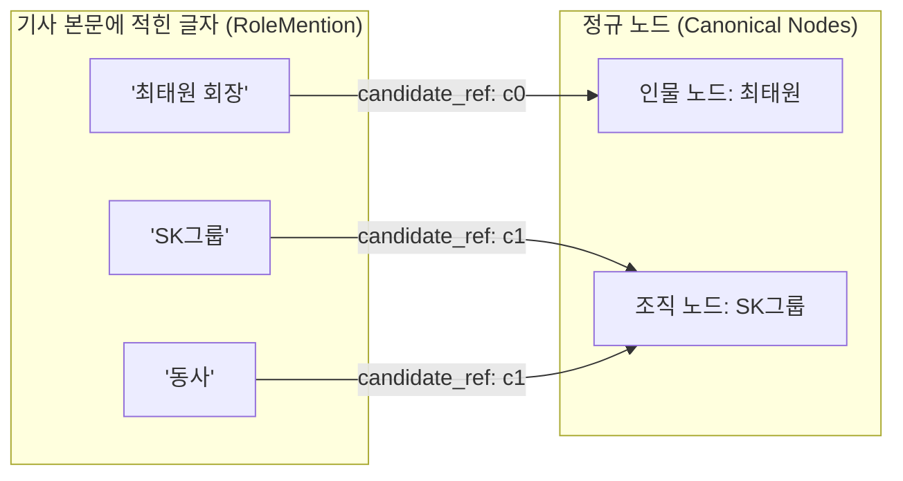
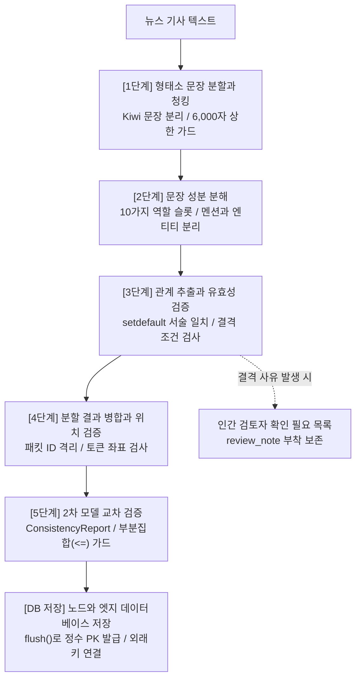

뉴스 기사나 문서에서 인물, 기업 같은 개체(노드)를 찾고, 이들 사이의 관계(엣지)를 추출해 지식 그래프로 구축하는 파이프라인을 다룬다. 방대한 비정형 텍스트를 구조화된 그래프 형태로 정리해 두면 엔티티 간의 연결 고리를 파악하고 검색하는 데 유용하다.

하지만 LLM에게 단순 프롬프트로 "엔티티와 관계를 뽑아줘"라고 요청하면, 엉뚱한 관계를 지어내거나 조사와 직책이 붙은 불완전한 노드가 생성된다. 모델이 글의 문맥을 이해하는 것과 정형 데이터의 무결성 규칙을 지키는 것은 완전히 다른 문제이기 때문이다.

이러한 문제를 해결하기 위해 실제 프로젝트(`ontology-map-workspace`)에서는 언어 모델에게는 문맥 파악과 성분 분해만 맡기고, 데이터의 연결과 유효성 검증은 파이썬 코드가 직접 수행하는 5단계 파이프라인을 구축했다.

본 포스트에서 다루는 파이프라인은 개별 기사 단위의 비정형 텍스트로부터 노드와 엣지를 정제하는 **문서 수준(Document-level) 추출**에 초점을 맞춘다. 여러 문서에 걸쳐 동일 대상을 하나로 통합하는 전역 엔티티 해소(Global Entity Resolution)에 앞서, 개별 기사 내부에서 노드와 관계의 무결성을 먼저 확보하는 것이 본 파이프라인의 핵심 목표다.

거대한 파이프라인 코드를 한 번에 살펴보면 복잡한 데이터 구조와 검증 로직이 한데 얽혀 있어 전체 흐름을 놓치기 쉽다. 따라서 텍스트 전처리부터 데이터베이스 적재까지 이어지는 각 단계를 최소 단위의 뼈대(Skeleton)로 나누고, 각 코드의 구체적인 동작 흐름과 데이터 구조의 역할을 단계별로 짚어본다.

---

## 1. 지식 그래프 직접 추출의 문제점

언어 모델에게 텍스트를 주고 최종 그래프(노드와 엣지)를 한 번에 뽑아내게 했을 때 가장 자주 발생하는 문제는 **문장 내 동시 등장에 따른 허위 관계 생성**이다.

프롬프트에 관계 정의를 명확히 적어주더라도 실제 기사 문장을 넣어보면 곧바로 한계가 드러난다.

> "A사는 C사와의 차세대 AI 반도체 공급 계약 체결식에서 신제품 양산 계획을 발표했으며, 이 자리에는 주요 고객사인 B사 대표도 함께 배석했다."

사람이 이 문장을 읽으면 공급 계약의 당사자는 'A사'와 'C사'이고, 'B사'는 축하하러 참석한 손님이라는 사실을 바로 안다. 하지만 단순 프롬프트로 관계를 추출하라고 시키면, 모델은 한 문장에 세 회사가 나란히 등장했다는 이유만으로 'A사 ➔ 공급 계약 ➔ B사'라거나 'B사 ➔ 협력 ➔ C사' 같은 거짓 관계를 자연스럽게 지어낸다. 단순히 같은 문장에 함께 나왔다는 사실만으로 관계를 엮어버리는 전형적인 오류다.

또 다른 문제는 **한국어 조사와 수식어 분리 실패**다. 기사 본문에 "최태원 SK그룹 회장"이라는 표현이 나왔을 때 모델은 다음과 같이 제각각으로 행동한다:

1. "최태원 SK그룹 회장" 전체를 한 덩어리로 묶어서 하나의 인물 노드로 만든다.
2. "회장"이라는 직책을 별도의 노드로 떼어내 엉뚱한 관계를 잇는다.
3. "최태원"이라는 인물이 "SK그룹" 소속이라는 관계를 빠뜨린다.
4. 문맥상 같은 대상을 가리키는 "동사", "이 회사" 같은 표현을 정규 노드로 연결하지 못하고 독립된 노드로 만들어 버린다.

언어 모델은 확률에 따라 가장 그럴듯한 다음 단어를 이어 붙이는 방식으로 동작한다. 따라서 모델 하나에 텍스트 문맥 이해부터 정형 데이터 무결성 검증까지 모든 역할을 떠넘기면 두 작업 모두 어긋나기 쉽다.

해결책은 역할을 나누는 것이다. 언어 모델은 텍스트를 읽고 주어, 목적어, 행동 같은 기본 성분을 표 형태로 채우는 작업까지만 맡고, 그 표를 바탕으로 실제 노드를 확정하고 잘못된 관계를 걸러내는 작업은 파이썬 코드가 직접 검증하도록 파이프라인을 나누어야 한다.

---

## 2. 형태소 기반 문장 분할과 청킹

파이프라인의 첫 단계는 긴 글을 문장 단위로 정확하게 자르고, 모델이 한 번에 읽기 좋은 크기의 묶음(청크)으로 나누는 전처리다.

언뜻 생각하면 원문 텍스트를 줄바꿈(`\n`)이나 마침표(`.`) 기준으로 단순 분할하면 충분할 것 같다. 하지만 실제 뉴스 기사를 다뤄보면 곧바로 텍스트가 깨진다. 기사에는 "A.I. 반도체", "주식회사 A.B.C", "전년 대비 1.5% 성장"처럼 약어나 소수점에 마침표가 들어간 문장이 수없이 많기 때문이다. 마침표 단위로 단순 split을 해버리면 소수점이나 약어 중간에서 문장이 엉뚱하게 두 동강 난다.

이 문제를 해결하기 위해 한국어 형태소 분석기인 Kiwi를 사용한다. Kiwi는 문장의 문자열만 단순 분리하는 것이 아니라 형태소를 분석한다. 따라서 "1.5%"나 "A.I."의 마침표는 문장 끝이 아니라는 점을 알고 지나가며, "발표했다", "도입할 예정이다"처럼 실제 종결 어미(`EF`)가 나타나는 지점에서만 문장을 분리해 준다. 덕분에 약어나 소수점이 포함되어 있어도 문장이 온전하게 유지된다.

```python
from pydantic import BaseModel
from kiwipiepy import Kiwi

# 프론트엔드나 호출자에게 일관된 에러 응답을 전달하기 위한 프로젝트 공통 예외 래퍼
def fail(code: str) -> Exception:
    return ValueError(f"[PIPELINE_ERROR] {code}")

class SourceSpan(BaseModel):
    id: str      # 문장 고유 ID (예: u0, u1)
    start: int   # 원문 텍스트 내 시작 글자 위치
    end: int     # 원문 텍스트 내 끝 글자 위치
    text: str    # 문장 텍스트 내용
    source: str  # 출처

def create_source_spans(content: str, kiwi: Kiwi) -> list[SourceSpan]:
    stripped = content.strip()
    # 텍스트가 아예 비어있으면 조기에 거부
    if not stripped:
        raise fail("DOCUMENT_HAS_NO_TEXT")
    # 너무 거대한 문서는 메모리와 처리 비용 보호를 위해 제한
    if len(stripped) > 50000:
        raise fail("DOCUMENT_TOO_LARGE")

    spans = []
    # Kiwi의 형태소 분석 기반 문장 분리 실행
    for idx, sentence in enumerate(kiwi.split_into_sents(stripped)):
        spans.append(
            SourceSpan(
                id=f"u{idx}",
                start=sentence.start,
                end=sentence.end,
                text=sentence.text,
                source="raw_input"
            )
        )
    return spans
```

`create_source_spans` 함수는 입력 문자열 `content`의 앞뒤 공백을 `strip()`으로 정돈한 뒤, 빈 텍스트이거나 5만 자를 넘으면 `fail()` 함수로 조기 차단한다. 여기서 `raise ValueError` 대신 프로젝트 자체 래퍼인 `fail()`을 사용하는 이유는, 백엔드 API 환경에서 원시 예외가 그대로 튀어나가 500 서버 에러로 이어지는 것을 막고 호출자에게 제어된 에러 코드(`DOCUMENT_HAS_NO_TEXT`)를 전달하기 위함이다.

그 후 `kiwi.split_into_sents()`를 실행하면 Kiwi가 형태소 분석을 거친 문장 객체들을 차례로 반환한다. 각 문장 객체 `sentence`에는 분리된 문자열(`sentence.text`)뿐만 아니라, 원문 텍스트 내에서의 시작 문자 인덱스(`sentence.start`)와 끝 문자 인덱스(`sentence.end`)가 오프셋으로 들어있다. 이 오프셋을 `SourceSpan` 객체에 함께 담아두어야, 이후 5단계에서 개체 노드의 이름을 모델이 지어내지 않고 원문 텍스트의 정확한 좌표 구간에서 슬라이싱할 수 있다.

이렇게 나눈 문장 조각들을 모델에 보낼 때는 일정한 크기의 묶음(청크)으로 묶어서 보내야 한다. 문장을 한 개씩 보내면 문맥이 완전히 단절된다. "이 회사는 투자를 결정했다"라는 문장 하나만 모델에 보내면, 앞 문장에 나왔던 "SK하이닉스"라는 주어를 볼 수 없으므로 대명사를 해석하지 못한다. 또한 기사 하나에 50문장이 있다면 API를 50번 호출해야 하므로 속도와 비용이 낭비된다. 

반대로 수만 자에 달하는 기사 전체를 한 번에 보내면, 모델이 중간 내용을 놓치거나 앞 문단의 회사와 뒷 문단의 회사를 억지로 엮는 환각이 발생한다. 따라서 문맥을 파악하면서도 한 번에 너무 많은 내용이 들어가지 않도록 최대 8문장, 6,000자 단위로 문장들을 바구니에 나누어 담는 청킹 작업을 수행한다.

```python
def bundle_packets(spans: list[SourceSpan]) -> list[list[SourceSpan]]:
    MAX_UNITS = 8      # 한 패킷에 담을 최대 문장 수
    MAX_CHARS = 6000   # 한 패킷에 담을 최대 글자 수
    
    packets = []
    current_packet = []
    current_chars = 0

    for span in spans:
        span_len = len(span.text)
        
        # [핵심 방어] 단일 문장 자체가 6,000자를 넘는 비정상 텍스트 조기 차단
        if span_len > MAX_CHARS:
            raise fail("UNIT_TOO_LARGE")

        # 기존 바구니가 꽉 찼거나 글자 수가 넘치면 기존 바구니를 저장하고 새로 시작
        if current_packet and (len(current_packet) >= MAX_UNITS or current_chars + span_len > MAX_CHARS):
            packets.append(current_packet)
            current_packet = []
            current_chars = 0

        current_packet.append(span)
        current_chars += span_len

    # 루프 종료 후 마지막으로 담고 있던 바구니 추가
    if current_packet:
        packets.append(current_packet)

    return packets
```

`bundle_packets` 함수는 `spans` 리스트를 받아 결과를 담을 `packets` 리스트와 현재 채우고 있는 바구니 `current_packet`, 글자 수 합계 `current_chars`를 초기화하고 반복문을 시작한다. 

루프에서는 매 문장의 글자 수 `span_len`을 구하고, `current_packet`에 문장이 이미 있으면서 문장 수가 8개(`MAX_UNITS`)에 도달했거나 새 문장을 더했을 때 6,000자(`MAX_CHARS`)를 넘는다면 현재 바구니를 `packets`에 집어넣고 새 바구니를 비운다. 그런 다음 현재 문장을 바구니에 담고 글자 수를 누적한다. 

여기서 `span_len > MAX_CHARS` 검사가 필요한 이유는 단일 문장 자체가 6,000자를 넘는 경우를 걸러내기 위해서다. 만약 이 검사가 없으면, 문장 하나가 10,000자에 달하더라도 루프 조건에 의해 기존 패킷만 비워지고 10,000자짜리 문장 하나가 새 패킷에 담겨 그대로 반환된다. 따라서 루프 첫머리에서 단일 문장의 길이 상한을 먼저 검사하여 `fail("UNIT_TOO_LARGE")`로 차단한다.

---

## 3. 문장 성분 분해와 역할 스키마

두 번째 단계는 문장에서 그래프를 바로 그리지 않고, 주어, 목적어, 행동 같은 문장 성분을 10가지 역할 슬롯으로 분해하는 단계다.

기사 문장에서 개체들 간의 '관계'를 바로 도출하려 하면 아까 보았던 동시 등장 오류가 발생한다. 반면 문장을 언어학적 역할(누가, 누구와, 무엇을 대상으로, 어떤 행동을 했는가)로 쪼개어 표에 적게 하면 모델이 문장 구조에 집중하므로 거짓말을 훨씬 덜 하게 된다.

여기서 중요한 점은 **기사 원문에 등장하는 표현(Mention)과 실제 온톨로지 개체(Entity)의 분리**다. 

기사에는 "최태원 회장", "SK그룹", "동사", "이 회사"처럼 다양한 단어가 나온다. 기사에 쓰인 글자 그대로를 노드로 만들면 "동사"라는 이름의 유령 회사가 노드로 등록된다. 따라서 기사에 실제로 적혀 있던 글자는 증거를 포함한 멘션으로 따로 기록하고, 그 멘션이 가리키는 실제 개체 후보 식별자를 연결해 두어야 한다.

이 데이터 처리를 위해 뒤의 코드에서 살펴볼 세 가지 모델인 `Evidence`, `RoleMention`, `RoleSlot`을 순서대로 조립하여 사용한다.



기사에서 "동사는 투자를 진행했다"고 썼더라도, `RoleMention`이 가리키는 `candidate_ref`가 "SK그룹" 노드라면, 시스템은 "SK그룹"이라는 실제 회사 노드가 투자를 진행했다는 사실을 정확하게 파악할 수 있다. 단, 여기서 생성하는 `CandidateNode`는 해당 기사 본문 내에서 식별된 로컬 엔티티를 의미한다. 서로 다른 기사에서 추출된 노드들을 전역 그래프 차원에서 하나로 병합하는 작업은 이 파이프라인의 출력 데이터를 바탕으로 후속 단계에서 수행된다.

이 구조를 정의하는 Pydantic 코드는 다음과 같다.

```python
from typing import Literal
from pydantic import BaseModel, Field

# 1. 원문 인용 증거: 기사 원문의 어떤 글자를 인용했는지 저장
class Evidence(BaseModel):
    quote: str
    start: int | None = None
    end: int | None = None

# 2. 역할 멘션: 원문 문장(unit_id)에서 인용한 글자와, 그것이 가리키는 개체 후보 번호(candidate_ref)
class RoleMention(BaseModel):
    unit_id: str
    evidence: Evidence
    candidate_ref: str | None = None

# 3. 역할 슬롯: 해당 역할이 문장에 명시되었는지(explicit), 언급이 없는지(not_stated), 
# 애매한지(ambiguous)의 상태와 함께 멘션 목록을 보관
class RoleSlot(BaseModel):
    status: Literal["explicit", "not_stated", "ambiguous"]
    mentions: list[RoleMention] = Field(default_factory=list, max_length=10)
    note: str | None = Field(default=None, max_length=200)

# 4. 하나의 주장(Assertion)을 이루는 10가지 역할 슬롯
class AssertionRoles(BaseModel):
    id: str
    unit_id: str
    action: str
    modality: Literal["fact", "plan", "unresolved"] = "fact"
    polarity: Literal["positive", "negative"] = "positive"
    
    # 10가지 역할 슬롯 (행위자, 협력자, 수혜자, 대상물, 적용처, 발언자, 조건, 목표, 지표, 수단)
    actors: RoleSlot = Field(default_factory=RoleSlot)
    partners: RoleSlot = Field(default_factory=RoleSlot)
    recipients: RoleSlot = Field(default_factory=RoleSlot)
    objects: RoleSlot = Field(default_factory=RoleSlot)
    applications: RoleSlot = Field(default_factory=RoleSlot)
    speakers: RoleSlot = Field(default_factory=RoleSlot)
    conditions: RoleSlot = Field(default_factory=RoleSlot)
    goals: RoleSlot = Field(default_factory=RoleSlot)
    metrics: RoleSlot = Field(default_factory=RoleSlot)
    instruments: RoleSlot = Field(default_factory=RoleSlot)
```

이 스키마는 네 가지 모델이 아래에서 위로 조립되는 구조다.

1. **`Evidence`**: 원문 인용 글자(`quote`)와 그 글자가 위치한 시작·끝 오프셋(`start`, `end`)을 담는다. 모델이 인용한 근거 텍스트를 추적하는 최소 단위다.
2. **`RoleMention`**: 어느 문장에서 인용했는지를 나타내는 문장 ID(`unit_id`), 인용 텍스트 객체(`evidence`), 그리고 이 표기가 가리키는 정규 개체 후보 식별자(`candidate_ref`)를 묶는다. "이 회사", "최태원 회장" 같은 텍스트 표기형이 실제 어떤 정규 엔티티(`c0`, `c1`)를 가리키는지 연결하는 핵심 다리다.
3. **`RoleSlot`**: 슬롯 상태(`status`)와 멘션 목록(`mentions`)을 담는다. 문장에 정보가 명확히 적혀 있으면 `explicit`, 언급이 없으면 `not_stated`, 누구인지 모호하면 `ambiguous`로 상태를 지정하여 임의의 오타가 들어오는 것을 방지한다.
4. **`AssertionRoles`**: 기사 문장 하나에서 추출한 완성된 주장 단위다. 행동(`action`), 사실/계획 여부(`modality`), 긍정/부정 여부(`polarity`)와 함께 행위자(`actors`), 협력자(`partners`), 수혜자(`recipients`), 대상물(`objects`), 적용처(`applications`) 등 10가지 역할 슬롯을 멤버로 가진다.

여기서 `mentions: list[RoleMention] = Field(default_factory=list)`를 사용한 이유는 파이썬의 가변 객체 참조 공유 문제를 방어하기 위함이다. 파이썬 클래스에서 흔히 하듯 `mentions = []`처럼 빈 리스트를 기본값으로 직접 넣으면, 인터프리터 특성상 모든 슬롯 인스턴스가 같은 메모리 주소를 공유하게 되어 인스턴스 간에 리스트 객체를 공유하는 문제가 발생한다. `default_factory=list`를 지정해야 인스턴스가 생성될 때마다 매번 독립된 새 리스트가 할당된다.

---

## 4. 엔티티 관계 추출과 유효성 검증

앞서 3단계에서 언어 모델이 채워 넣은 것은 주어, 목적어, 행동 등이 적힌 10개 슬롯 표였다. 이제 이 표를 바탕으로 **'A 노드에서 B 노드로 가는 관계 화살표(간선)'를 실제로 만들어도 안전한지 검사하는 필터**가 필요하다.

`qualify_candidate_rows` 함수가 바로 그 역할을 한다. 모델이 제안한 간선 후보(`rows`)와 원천 주장 표(`table_assertions`)를 넘겨받아, 두 노드를 실제로 이어도 문제가 없는지 조건들을 하나씩 대조하며 불량 간선을 걸러내는 핵심 필터 함수다.

이 검증 함수는 여러 단계의 유효성 검사가 얽혀 있어 전체 코드를 한 번에 읽으면 핵심 흐름을 파악하기 어렵다. 함수의 동작을 명확히 이해하기 위해 가장 핵심적인 뼈대 로직부터 살펴본다.

### 1단계: 5줄짜리 최소 뼈대 함수

가장 기본적인 뼈대 코드는 다음과 같다.

```python
def qualify_candidate_rows_skeleton(rows, table):
    # 매번 리스트를 선형 탐색하지 않도록 딕셔너리로 O(1) 룩업 맵 생성
    assertions = {item.id: item for item in table.assertions}
    for row in rows:
        assertion = assertions.get(row.assertion_id or "")
        if assertion is None:
            raise fail("ASSERTION_PROJECTION_INVALID")
```

이 최소 뼈대의 핵심은 매번 리스트를 순회하지 않고 $O(1)$로 참조할 수 있는 룩업 딕셔너리를 구성하는 것이다. 수많은 행(`rows`)이 각자 참조하고 있는 주장(`assertion_id`)이 실제로 존재하는지 확인하는 것이 이 함수의 출발점이다.

### 2단계: 튜플 키와 setdefault를 통한 모순 검사

주장 매핑 이후에는 동일한 주장 ID에 서로 모순된 진술이 유입되는 것을 방어해야 한다. 이때 파이썬의 `dict.setdefault()`와 튜플 복합 키를 활용하면 간결하게 해결할 수 있다.

```python
content_key = (row.statement, row.scope.model_dump_json())
if statements.setdefault(assertion.id, content_key) != content_key:
    raise fail("ASSERTION_PROJECTION_INVALID")
```

`content_key`는 파이썬에서 불변(Immutable) 값인 튜플(`tuple`)을 이용해 '서술 문장'과 '스코프'를 하나의 복합 키로 묶어둔 것이다. 그리고 `dict.setdefault(key, default)`는 키가 없으면 기본값을 등록하고 반환하지만, 이미 키가 있으면 기존에 저장되어 있던 값을 그대로 반환한다.

즉, 동일한 주장 ID(`assertion.id`)를 바라보는 여러 관계 행이 서로 다른 원문 서술이나 스코프를 제시하면, `setdefault`가 반환한 기존 값과 현재의 `content_key`가 달라진다. 이를 통해 한 주장에 서로 다른 모순된 진술이 들어오는 것을 $O(1)$ 속도로 깔끔하게 잡아낼 수 있다.

### 3단계: 어색한 삼항 연산자 정돈

기존 코드베이스에서 눈에 걸렸던 삼항 연산자 구문도 정돈할 필요가 있었다.

```python
# ❌ 거짓일 때 자기 자신을 다시 대입하는 어색한 구문
row.subject_ref = None if row.kind != "metric" else row.subject_ref
```

삼항 연산자를 무리하게 쓰려다 가독성이 떨어진 코드다. 직관적인 단일 조건문으로 분기하는 것이 훨씬 명확하다:

```python
# ⭕ 직관적인 클린 코드로 분기
if row.kind != "metric":
    row.subject_ref = None
```

### 4단계: 살을 붙여 완성한 qualify_candidate_rows

이러한 단계적 검증과 리팩터링을 반영하여 완성한 코드는 다음과 같다.

```python
class CandidateRow(BaseModel):
    id: str
    assertion_id: str | None = None
    kind: Literal["relation", "metric", "attribute"] = "relation"
    source_ref: str              # 출발지 노드 참조 (예: c0)
    target_ref: str              # 도착지 노드 참조 (예: c1)
    relation: str                # 관계 이름 (예: USES, PRODUCES)
    statement: str               # 관계의 원문 서술
    modality: str = "fact"       # 양상 (fact, plan 등)
    subject_ref: str | None = None
    review_note: str | None = None # 검토가 필요한 사유 기록

def qualify_candidate_rows(rows: list[CandidateRow], table_assertions: list[AssertionRoles]) -> None:
    assertions = {item.id: item for item in table_assertions}
    statements: dict[str, str] = {}

    for row in rows:
        assertion = assertions.get(row.assertion_id or "")
        if assertion is None:
            raise fail("ASSERTION_PROJECTION_INVALID")

        # 1. 동일한 주장 ID인데 서술 문장이 다른 모순 검사
        previous_statement = statements.setdefault(assertion.id, row.statement)
        if previous_statement != row.statement:
            raise fail("ASSERTION_PROJECTION_INVALID")

        # 2. 리팩터링한 주체 참조 초기화
        if row.kind != "metric":
            row.subject_ref = None

        # 3. 유효한 출발지와 도착지 후보 집합 구성
        valid_sources = {m.candidate_ref for m in assertion.actors.mentions if m.candidate_ref}
        valid_sources |= {m.candidate_ref for m in assertion.partners.mentions if m.candidate_ref}

        valid_targets = {m.candidate_ref for m in assertion.objects.mentions if m.candidate_ref}
        valid_targets |= {m.candidate_ref for m in assertion.recipients.mentions if m.candidate_ref}

        # 4. 잘못된 관계를 걸러내는 조건들 검사
        disqualified_reasons = []

        if row.source_ref not in valid_sources:
            disqualified_reasons.append("출발지가 행위자 슬롯에 없음")
        if row.target_ref not in valid_targets:
            disqualified_reasons.append("도착지가 대상물 슬롯에 없음")
        if row.source_ref == row.target_ref:
            disqualified_reasons.append("출발지와 도착지가 같은 셀프 루프")
        if assertion.modality not in {"fact", "plan"}:
            disqualified_reasons.append(f"불확실한 양상({assertion.modality})")
        if assertion.polarity != "positive":
            disqualified_reasons.append("부정문 서술")
        if assertion.conditions.status == "ambiguous":
            disqualified_reasons.append("조건이 모호함")

        # [중요] 부적격 간선은 지우지 않고 review_note를 달아 인간 검토자에게 위임
        if disqualified_reasons:
            row.review_note = " / ".join(disqualified_reasons)
```

이 완성 코드는 루프 안에서 세부 유효성 검사를 차례대로 수행한다.

먼저 출발지 노드는 행위자 슬롯이나 협력 파트너 슬롯에 적힌 개체여야 하므로 `{m.candidate_ref for m in assertion.actors.mentions if m.candidate_ref} | partners`로 합집합을 만든다. 도착지 역시 대상물(`objects`)과 수혜자(`recipients`)를 합집합으로 묶어 `valid_targets` 집합을 구성한다.

그 다음 조건문을 순서대로 검사한다:
- `row.source_ref not in valid_sources`: 출발지가 행위자 슬롯에 없으면 결격 사유에 추가한다.
- `row.target_ref not in valid_targets`: 도착지가 대상물 슬롯에 없으면 결격 사유에 추가한다.
- `row.source_ref == row.target_ref`: 자기 자신을 가리키는 셀프 루프이면 결격 사유에 추가한다.
- `assertion.modality not in {"fact", "plan"}`: 사실이나 계획이 아닌 불확실한 양상이면 결격 사유에 추가한다.
- `assertion.polarity != "positive"`: "투자를 진행하지 않았다" 같은 부정문이면 결격 사유에 추가한다.
- `assertion.conditions.status == "ambiguous"`: 전제 조건이 모호하면 결격 사유에 추가한다.

결격 사유가 발견되면 `row.review_note = " / ".join(disqualified_reasons)`로 행에 사유를 적어둔다. 여기서 중요한 실무 설계 관점은 **"결격 간선을 왜 `remove()`로 지우지 않는가?"**이다. 출발지나 도착지가 슬롯에 맞지 않거나 셀프 루프를 도는 간선이 발견되었을 때, 이를 파이썬 코드에서 조용히 삭제해 버리면 관리자는 모델이 무슨 실수를 했는지 알 수 없다. 따라서 행 객체를 그대로 살려두고 `review_note`에 탈락 사유를 적어둠으로써, 관리자 화면의 '확인 필요' 큐로 넘겨 인간 검토자(HITL)가 최종 확인할 수 있게 한다.

---

## 5. 분할 결과 병합과 원문 위치 검증

네 번째 단계는 앞서 청크(패킷)별로 나누어 추출했던 결과들을 하나로 합치고, 개체들의 이름이 원문 텍스트의 실제 위치에 기반하고 있는지 좌표를 검증하는 단계다.

### 패킷 병합: 그냥 합치면 왜 안 되는가?

패킷 단위로 나누어 처리한 결과를 단순히 리스트로 합치면 식별자 충돌이 발생한다. 패킷 0번에서도 첫 번째 행은 `r0`이고, 패킷 1번에서도 첫 번째 행은 `r0`이기 때문이다. 각 패킷 안에서 0번부터 번호를 매겼기 때문에, 단순 결합 시 앞선 패킷의 행들이 뒤선 패킷에 의해 덮어씌워지며 참조 관계가 뒤죽박죽 엉킨다. 

따라서 각 패킷 번호를 접두사로 붙여 `p0:r0`, `p1:r0`처럼 식별자를 격리해 주어야 한다.

```python
def merge_candidate_bundles(bundles: list[list[CandidateRow]]) -> list[CandidateRow]:
    merged_rows = []
    for packet_idx, rows in enumerate(bundles):
        for row in rows:
            # 패킷 번호를 접두사로 붙여서 ID 충돌 방지
            row.id = f"p{packet_idx}:{row.id}"
            if row.assertion_id:
                row.assertion_id = f"p{packet_idx}:{row.assertion_id}"
            merged_rows.append(row)
    return merged_rows
```

`merge_candidate_bundles` 함수는 청크별로 분할 처리된 행 리스트들을 받아서 `enumerate(bundles)`로 패킷 번호(`packet_idx`)를 붙인다. 각 행의 ID를 `row.id = f"p{packet_idx}:{row.id}"`로 바꾸고 참조하는 주장 ID도 접두사를 붙여 변경한다. 이렇게 하면 패킷 0의 `r0`은 `p0:r0`이 되고, 패킷 1의 `r0`은 `p1:r0`이 되어 단순 리스트 결합 시 앞선 데이터가 덮어씌워지는 ID 충돌을 완벽히 방지한다.

### 노드 카탈로그: 부등호 검사와 순서 보존의 이유

앞선 단계에서 추출한 것은 문장 속 멘션들과 관계 행들이었을 뿐, 아직 우리 시스템에는 **'이 그래프에 최종적으로 존재하는 공식 노드 목록'**이 없다. 

`catalog_nodes` 함수가 바로 그 역할을 한다. 모델이 제안한 개체 후보 목록(`selected_items`)을 넘겨받아 중복을 없애고, 실제 원문 텍스트의 토큰 구간을 슬라이싱하여 공식 노드 목록(`CandidateNode`)을 확정하는 함수다.

여기서 입력 인자인 `tokens_by_unit`은 전처리 단계에서 만들어둔 문장별 형태소 토큰 딕셔너리다. 예를 들어 `{"u0": ["SK", "하이닉스", "는", "엔비디아", "와", ...]}`처럼 문장 ID를 키로 삼고 형태소 토큰들의 배열을 값으로 갖는다.

```python
class CandidateNode(BaseModel):
    id: str
    name: str
    classification: str
    evidence_unit_ids: list[str] = Field(default_factory=list)

def catalog_nodes(
    selected_items: list[dict], 
    units_by_id: dict[str, SourceSpan], 
    tokens_by_unit: dict[str, list[str]]
) -> list[CandidateNode]:
    nodes = []

    for item in selected_items:
        unit_id = item["unit_id"]
        first_span = item["first_span_id"]
        last_span = item["last_span_id"]
        tokens = tokens_by_unit.get(unit_id, [])

        # 1. 모델이 음수(-1)를 보내거나 시작과 끝을 거꾸로 보낸 환각 차단
        if not (0 <= first_span <= last_span < len(tokens)):
            raise fail("INVALID_SPAN_COORDINATES")

        # 2. 증거 문장 ID의 실존 여부 검사
        evidence_ids = item.get("evidence_unit_ids", [])
        if not set(evidence_ids) <= units_by_id.keys():
            raise fail("INVALID_EVIDENCE_UNIT")

        # 3. 본 문장(unit_id)을 0순위로 유지하며 순서 보존 중복 제거
        ordered_evidence = list(dict.fromkeys([unit_id, *evidence_ids]))

        # 검증된 토큰 좌표를 슬라이싱하여 실제 원문 글자 그대로 노드 이름 확정
        node_name = "".join(tokens[first_span : last_span + 1])
        nodes.append(
            CandidateNode(
                id=item["id"],
                name=node_name,
                classification=item["classification"],
                evidence_unit_ids=ordered_evidence
            )
        )

    return nodes
```

`catalog_nodes` 함수는 모델이 선택한 개체 목록(`selected_items`)을 돌며 노드 목록을 확정한다. 각 항목에서 `unit_id`, `first_span_id`, `last_span_id`를 꺼내고, `tokens_by_unit.get(unit_id, [])`로 해당 문장의 토큰 리스트를 가져온다. 

여기서 첫 번째 검사는 **LLM의 좌표 환각 차단**이다. 모델에게 노드 이름을 직접 쓰게 하지 않고 토큰 번호를 찍게 했는데, 모델이 가끔 음수(`-1`)를 보내거나 시작 번호가 끝 번호보다 큰 거꾸로 된 좌표(시작=5, 끝=2)를 보내는 경우가 있다. 이를 `0 <= first <= last < len(tokens)` 부등호 검사 하나로 깔끔하게 막아낸다.

두 번째 검사는 **증거 문장 ID의 실존 여부 확인**이다. `set(evidence_ids) <= units_by_id.keys()`를 통해 모델이 참조했다고 지목한 문장 ID들이 실제 전처리 단계에서 생성된 문장 집합에 속하는지 확인하여 유령 문장 참조를 차단한다.

세 번째는 **본 문장의 순서 보존**이다. `ordered_evidence = list(dict.fromkeys([unit_id, *evidence_ids]))`를 호출하여, 개체가 최초 정의된 본 문장(`unit_id`)을 증거 목록의 0순위(맨 앞)에 고정한 채 추가 증거 문장의 중복만 순서를 보존하며 제거한다. 파이썬 `set()`은 중복을 없애주지만 순서를 무작위로 섞어버리므로, 사후 추적을 위해 순서가 보장되는 `dict.fromkeys()`를 활용했다.

마지막으로 검증된 좌표 구간을 슬라이싱하여 `"".join(tokens[first_span : last_span + 1])`로 원문 글자 그대로 노드 이름을 확정한다. 복잡해 보이는 파이프라인 코드도 입력과 출력 데이터의 구조(그릇의 모양)를 먼저 파악하면 로직 자체는 지극히 직관적임을 알 수 있다.

---

## 6. 별도 모델 교차 검증과 무결성 확인

다섯 번째 단계는 추출 작업을 수행한 모델과 완전히 독립된 2차 검증 전용 모델을 실행하여, 앞서 만들어진 노드와 관계 번들을 검사하는 단계다.

추출을 수행한 모델에게 결과 검토까지 맡기면 자신이 범한 환각을 그대로 옳다고 판단하기 쉽다. 따라서 추출 모델과 분리된 별도의 검증 프롬프트를 사용하는 2차 모델을 실행하여, 원문 기사와 대조 검토한 보고서(`ConsistencyReport`)를 작성하게 한다.

그런데 이 검증 모델 역시 언어 모델이기 때문에, 검사를 대충 건너뛰거나 있지도 않은 가짜 ID를 지목하는 환각을 일으킬 수 있다. 따라서 보고서 자체를 파이썬 코드로 전수 검사한다.

```python
class NodeContentCheck(BaseModel):
    node_id: str
    status: Literal["supported", "unsupported", "needs_review"]
    reason: str = Field(min_length=1, max_length=500)

class ConsistencyIssue(BaseModel):
    node_ids: list[str] = Field(default_factory=list)
    row_ids: list[str] = Field(default_factory=list)
    message: str

class ConsistencyReport(BaseModel):
    checked_unit_ids: list[str] = Field(default_factory=list)
    nodes: list[NodeContentCheck] = Field(default_factory=list)
    issues: list[ConsistencyIssue] = Field(default_factory=list)

def validate_consistency_report(
    report: ConsistencyReport, 
    all_units: dict[str, SourceSpan], 
    bundle_nodes: list[CandidateNode], 
    bundle_rows: list[CandidateRow]
) -> None:
    # 1. 감사 모델이 전체 문장을 빠짐없이 다 확인했는지 검사
    if set(report.checked_unit_ids) != all_units.keys():
        raise fail("CONSISTENCY_REPORT_INVALID")

    # 2. 감사 모델이 이번 번들에 포함된 노드를 빠짐없이 다 확인했는지 검사
    existing_node_ids = {node.id for node in bundle_nodes}
    reported_node_ids = {check.node_id for check in report.nodes}
    if reported_node_ids != existing_node_ids:
        raise fail("CONSISTENCY_REPORT_INVALID")

    # 3. [핵심] 감사 모델이 문제를 지적하면서 적어낸 ID가 실제로 존재하는 ID인지 부분집합(<=)으로 검사
    existing_row_ids = {row.id for row in bundle_rows}
    for issue in report.issues:
        # 가짜 노드 ID를 지어냈는지 차단
        if not set(issue.node_ids) <= existing_node_ids:
            raise fail("CONSISTENCY_REPORT_INVALID")
        # 가짜 간선 ID를 지어냈는지 차단
        if not set(issue.row_ids) <= existing_row_ids:
            raise fail("CONSISTENCY_REPORT_INVALID")
```

보고서 모델은 세 가지로 구성된다:
- `NodeContentCheck`: 특정 노드 ID(`node_id`)가 원문에 의해 지지되는지(`supported`, `unsupported`, `needs_review`)와 그 이유(`reason`)를 적는다.
- `ConsistencyIssue`: 문제가 발견된 노드 ID 목록(`node_ids`), 관계 ID 목록(`row_ids`), 설명 메시지(`message`)를 담는다.
- `ConsistencyReport`: 검사한 문장 ID 목록(`checked_unit_ids`), 노드 검사 결과 목록(`nodes`), 발견된 이슈 목록(`issues`)을 담는다.

보고서를 검증하는 `validate_consistency_report` 함수는 세 단계의 집합 검사를 수행한다:

1단계는 `set(report.checked_unit_ids) != all_units.keys()`이다. 검증 모델이 점검했다고 보고서에 적어낸 문장 ID 집합과 전체 원문 문장 ID 집합이 일치하는지 비교하여, 문장을 건너뛰고 대충 검사한 보고서를 차단한다.

2단계는 `{node.id for node in bundle_nodes}`와 `{check.node_id for check in report.nodes}`를 비교하여, 이번 번들에 포함된 모든 노드를 빠짐없이 전수 점검했는지 확인한다.

3단계는 `for issue in report.issues:`를 돌며 발견된 문제점 속의 식별자를 검사한다. 여기서 핵심은 **파이썬의 부분집합 연산자(`<=`)를 활용한 가짜 식별자 차단**이다. `not set(issue.node_ids) <= existing_node_ids`와 `not set(issue.row_ids) <= existing_row_ids`를 검사하여, 검증 모델이 지적하면서 적어낸 ID들이 실제 번들에 존재하는 ID들의 부분집합(`<=`)인지 확인한다. 

만약 번들에는 노드가 `c0`, `c1`, `c2` 세 개밖에 없는데, 검증 모델이 환각을 일으켜 "c99 노드가 이상합니다"라고 적어냈다면 `{'c99'}`는 기존 노드 집합의 부분집합이 아니므로 즉시 에러가 발생하며 가짜 지목 보고서가 차단된다. 집합 연산을 활용해 검증 모델이 존재하지 않는 ID를 지목하는 문제를 차단한다.

### 2차 검증의 비용과 지연 시간 최적화

독립된 2차 모델을 띄워 교차 검증 보고서를 작성하게 하는 방식은 환각과 오류를 걸러내는 데 효과적이지만, API 호출 횟수와 토큰 비용, 그리고 전체 파이프라인의 지연 시간(Latency)이 2배로 증가하는 명확한 트레이드오프가 존재한다.

따라서 실제 프로덕션 환경에서는 모든 청크에 2차 검증을 무조건 적용하기보다 다음과 같은 최적화 전략을 취한다:

1. **선별적 검증 실행**: 1단계 추출 결과의 신뢰도 점수가 낮거나, 3단계에서 조건부 검토 노트(`review_note`)가 부착된 모호한 청크에 한해서만 2차 검증 파이프라인을 가동하여 토큰 소모를 줄인다.
2. **비대칭 모델 배치**: 복잡한 문맥 파악과 역할 분해가 필요한 1단계 추출에는 고성능 대형 모델을 사용하고, 정해진 스키마와 원문을 단순 대조하는 2차 검증에는 경량 모델을 배치하여 비용과 응답 지연 시간을 통제한다.

---

## 7. 노드와 엣지의 데이터베이스 저장

마지막 단계는 검증을 모두 통과한 메모리상의 노드와 관계 데이터들을 실제 관계형 데이터베이스(RDBMS) 테이블에 안전하게 저장하는 단계다.

여기서 한 가지 짚고 넘어갈 점이 있다. 앞서 3~5단계에서 쓰던 `CandidateNode`, `CandidateRow`는 파이썬 메모리에서 유효성을 검사하기 위한 Pydantic 그릇이었다. 이제 실제 PostgreSQL이나 MySQL 테이블에 `INSERT`하기 위해서는 데이터베이스 테이블 스키마와 1:1로 매핑되는 저장용 레코드 모델(`NodeRecord`, `EdgeRecord`)로 변환하여 적재해야 한다.

이 데이터베이스 저장 로직에서는 두 가지 설계가 중요하다. 첫째는 메모리 임시 ID를 DB 정수 기본키(PK)로 치환하는 매핑이고, 둘째는 `session.flush()`를 활용한 2단계 적재다.

```python
class NodeRecord:
    def __init__(self, workspace_id: int, name: str, classification: str):
        self.id: int | None = None  # DB flush 후 자동으로 채번되는 정수 PK
        self.workspace_id = workspace_id
        self.name = name
        self.classification = classification

class EdgeRecord:
    def __init__(self, workspace_id: int, source_node_id: int, target_node_id: int, relation: str, properties: dict):
        self.workspace_id = workspace_id
        self.source_node_id = source_node_id
        self.target_node_id = target_node_id
        self.relation = relation
        self.properties = properties

def save_canonical_graph(session, workspace_id: int, nodes: list[CandidateNode], rows: list[CandidateRow]) -> None:
    # 임시 문자열 ID(c0) -> DB 정수 PK(101) 매핑 딕셔너리
    node_id_map: dict[str, int] = {}

    # 1. 노드를 먼저 DB 세션에 추가하고 정수 PK 발급받기
    for node in nodes:
        saved_node = NodeRecord(
            workspace_id=workspace_id,
            name=node.name,
            classification=node.classification
        )
        session.add(saved_node)
        # 중요: commit을 하지 않고 flush를 호출하여 DB 정수 번호만 미리 발급받음
        session.flush()
        
        node_id_map[node.id] = saved_node.id

    # 2. 발급받은 정수 PK를 이용해 간선(Edge)을 외래키로 연결하여 저장
    for row in rows:
        if row.kind != "relation" or row.review_note is not None:
            continue

        source_pk = node_id_map.get(row.source_ref)
        target_pk = node_id_map.get(row.target_ref)

        if source_pk is None or target_pk is None:
            raise fail("NODE_PK_NOT_FOUND")

        saved_edge = EdgeRecord(
            workspace_id=workspace_id,
            source_node_id=source_pk,
            target_node_id=target_pk,
            relation=row.relation,
            properties={
                "statement": row.statement,
                "modality": row.modality,
                "assertion_id": row.assertion_id
            }
        )
        session.add(saved_edge)

    # 모든 노드와 간선이 에러 없이 연결되었을 때 비로소 단 한 번 커밋
    session.commit()
```

`save_canonical_graph` 함수는 임시 문자열 ID를 DB의 정수 기본키로 변환하기 위해 `node_id_map: dict[str, int] = {}` 매핑 딕셔너리를 선언하고 시작한다.

1단계 노드 저장 루프에서는 각 노드에 대해 `NodeRecord(workspace_id, name, classification)` 인스턴스를 생성하여 `session.add(saved_node)`로 세션에 등록한다. 그리고 그 즉시 `session.flush()`를 호출한다. 임시 ID를 그대로 쓰지 않고 정수 PK로 바꾸는 이유는 데이터베이스의 인덱싱 성능과 외래키(FK) 제약조건 때문이다. 문자열 ID(`p0:r0`)는 길이가 가변적이고 조인할 때 인덱스 성능이 떨어진다. 반면 정수 기본키(Integer PK)는 메모리 효율이 좋고 외래키 결합이 매우 빠르다.

그리고 `session.flush()`를 쓰는 이유는 트랜잭션 롤백의 안전성 때문이다. 만약 노드를 넣을 때마다 매번 `commit()`을 해버리면, 중간에 간선을 연결하다가 에러가 났을 때 이미 들어간 노드들만 DB에 남아 롤백하기가 매우 번거로워진다. 반면 `session.flush()`를 쓰면 트랜잭션을 확정하지 않은 열린 상태로 유지하면서도, DB 시퀀스로부터 정수 PK를 미리 발급받아 `saved_node.id`에 채워 넣는다. 이 번호들을 `node_id_map[node.id] = saved_node.id`로 맵에 기록해 둔다.

2단계 간선 저장 루프에서는 `for row in rows:`를 돌며, 관계 타입이 아니거나 검토 노트가 붙은 결격 행은 정규 간선이 아니므로 `continue`로 건너뛴다. 그 다음 출발지와 도착지의 임시 ID로 맵에서 정수 PK를 조회한다: `node_id_map.get(row.source_ref)`, `node_id_map.get(row.target_ref)`. 만약 참조하는 노드의 PK가 없다면 `fail("NODE_PK_NOT_FOUND")`를 발생시킨다. 조회한 정수 PK를 `source_node_id`, `target_node_id`에 주입하여 `EdgeRecord`를 생성하고 세션에 추가한다.

마지막으로 모든 노드와 간선이 외래키 오류 없이 세션에 안전하게 적재되었을 때 맨 마지막에 `session.commit()`을 딱 한 번 호출함으로써, 도중에 문제가 생겨도 전체가 깨끗하게 롤백되도록 안전하게 처리할 수 있다.

---

## 8. 5단계 추출 파이프라인 종합 정리

비정형 텍스트로부터 지식 그래프를 추출하여 데이터베이스에 저장하기까지의 전체 5단계 흐름을 정리하면 다음과 같다.



이 파이프라인의 핵심은 언어 모델에게 모든 것을 맡기지 않고, 모델의 출력을 파이썬 코드가 단계별로 엄격하게 검증하도록 설계한 점이다.

1. **전처리**: Kiwi 형태소 분석을 통해 문장이 약어나 소수점에서 깨지지 않게 하고, 단일 문장 길이 검사로 패킷 상한 초과를 막았다.
2. **역할 분해**: 그래프를 바로 뽑지 않고 10가지 역할 슬롯으로 나누었으며, 본문 표기(멘션)와 실제 개체(엔티티)를 분리하여 대명사나 다양한 표기를 정규 노드로 모았다.
3. **유효성 검사**: 뼈대 코드부터 시작하여 `setdefault`로 동일 주장 내 서술 충돌을 잡고, 부적격 관계는 무단 삭제하지 않고 검토 노트를 달아 관리자에게 위임했다.
4. **병합과 좌표 확인**: 패킷별 ID 충돌을 방지하고, 모델이 환각을 지어내지 못하게 실제 원문 토큰 좌표를 슬라이싱하여 노드 이름을 확정했다.
5. **교차 검증과 저장**: 별도 감사 모델의 보고서를 집합 연산으로 검증한 뒤, `flush()`를 활용해 정수 PK를 먼저 발급받아 외래키로 안전하게 DB에 저장했다.

특히 3단계에서 결격 사유가 발생했을 때 점선으로 빠져나가는 **인간 검토자(HITL) 대기열**은 이 파이프라인에서 핵심적인 역할을 한다. 기계적 검증 코드가 아무리 촘촘해도 모든 모호한 자연어를 100% 판단할 수는 없다. 의심스러운 관계를 시스템이 임의로 폐기하지 않고 검토 노트를 달아 사람에게 안전하게 이관함으로써, 생성 AI를 실제 프로덕션 환경에 안정적으로 안착시킬 수 있다.

이렇게 기사 단위로 단단하게 정제된 노드와 엣지는 이후 수천, 수만 건의 기사가 모였을 때 전역 그래프 상에서 동일 개체를 묶어내는 전역 엔티티 해소(Global Entity Resolution)의 신뢰할 수 있는 기반 데이터가 된다.

언어 모델을 활용한 데이터 파이프라인에서 가장 중요한 것은 화려한 프롬프트가 아니라, 각 단계에서 어떤 그릇(Pydantic 스키마, 딕셔너리, 세트)에 데이터를 담고 어떻게 검증할지 명확히 정의하는 일이다. 거대한 코드를 최소 뼈대부터 하나씩 분해하고 데이터 구조를 선행하여 파악할 때, 비결정론적인 생성 AI의 출력을 신뢰할 수 있는 데이터로 변환하는 파이프라인을 안정적으로 구축할 수 있다.
