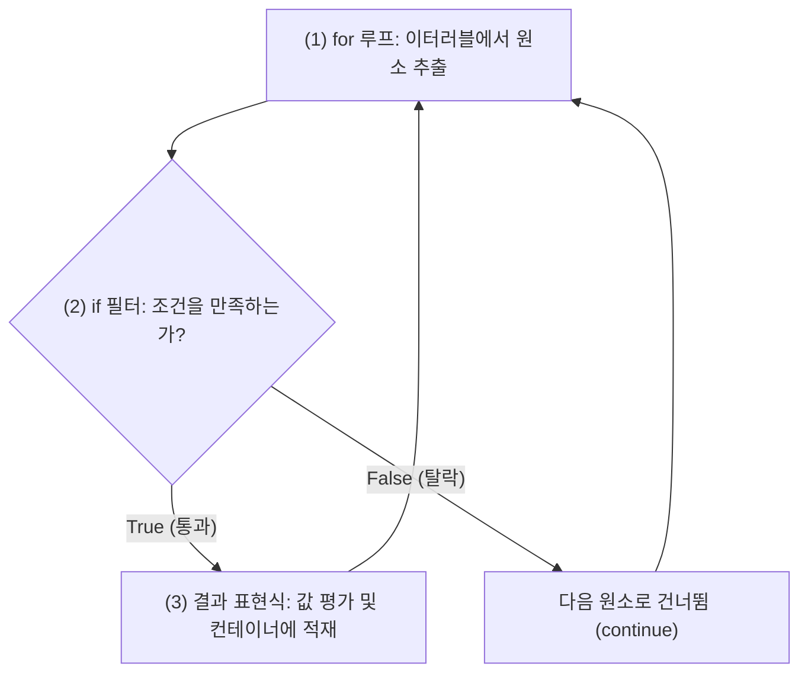

파이썬 컴프리헨션(Comprehension)은 코드를 한 줄로 간결하게 줄여주는 유용한 문법이다. 하지만 코드를 왼쪽에서 오른쪽으로 읽는 순서와 인터프리터가 실제로 평가하는 순서가 반대다. 이 때문에 조건이나 중첩 구조가 붙으면 흐름이 한눈에 들어오지 않는다.

`getattr` 조회, `if-else` 삼항 연산자, 중첩 집합(Set)이 함께 얽힌 다섯 가지 대표 패턴을 일반 `for` 루프로 풀어 설명한다. 각 패턴마다 실행 가능한 데이터와 출력 예시를 곁들여 실행 순서와 작성 규칙을 정리한다.

---

## 1. 컴프리헨션의 실행 순서

컴프리헨션이 낯설게 읽히는 이유는 작성 순서와 인터프리터의 평가 순서가 어긋나기 때문이다. 기본 문법 골격은 `[결과_표현식 for 변수 in 이터러블 if 필터_조건]` 형태지만, 실제 실행은 가운데 `for`부터 시작해 오른쪽 필터를 거친 뒤 맨 왼쪽 표현식으로 돌아온다.



1. **(1) 반복 (`for ... in ...`)**: 이터러블 객체에서 원소를 하나씩 꺼내 변수에 바인딩한다.
2. **(2) 검사 (`if ...`)**: 꺼낸 원소가 조건식을 만족하는지 검사한다. 거짓이면 아무 작업도 하지 않고 다음 원소로 넘어간다(`continue`).
3. **(3) 적재 (`결과 표현식`)**: 조건을 통과한 원소에 대해서만 맨 앞의 표현식을 평가하여 리스트, 세트, 또는 딕셔너리에 담는다.

일반 `for` 루프에서 매번 `list.append()` 메서드를 호출하는 방식과 달리, 컴프리헨션은 CPython 전용 바이트코드(`LIST_APPEND`, `MAP_ADD`)를 사용한다. 따라서 파이썬 함수 호출 비용 없이 C 수준에서 빠르게 컨테이너를 채운다.

---

## 2. 매핑과 딕셔너리 인덱싱

목록 데이터를 순회하면서 고유 ID를 키로 삼는 딕셔너리를 만드는 패턴이다. 주문 목록을 매번 처음부터 끝까지 뒤지지 않고($O(N)$), 주문 번호로 곧바로 꺼내기 위해($O(1)$) 자주 쓴다.

```python
from dataclasses import dataclass

@dataclass
class Order:
    id: str
    total: int

orders = [Order("ORD-101", 32000), Order("ORD-102", 18500)]

# 컴프리헨션: 주문 ID를 키로, Order 객체를 값으로 묶은 조회용 딕셔너리 생성
order_map = {order.id: order for order in orders}
print(order_map["ORD-102"])
# 출력: Order(id='ORD-102', total=18500)
```

위 한 줄을 일반 `for`문으로 풀면 빈 딕셔너리에 키와 값을 순서대로 대입하는 구조와 같다.

```python
order_map = {}
for order in orders:
    key = order.id
    order_map[key] = order
```

이 패턴에서 주의할 점은 **키 중복**이다. 파이썬 딕셔너리는 이미 존재하는 키에 새 값을 넣어도 에러를 내지 않고 기존 값을 덮어쓴다(Last Write Wins). 원본 목록에 같은 `id`가 두 번 들어 있으면 앞선 주문 데이터가 소리 없이 사라진다. ID 고유성을 반드시 지켜야 한다면 변환 전후 길이를 비교해 즉시 예외를 발생시키거나, 중복 목록을 묶는 `collections.defaultdict(list)`를 선택해야 한다.

```python
if len(order_map) != len(orders):
    raise ValueError("중복된 주문 ID가 존재해 데이터가 유실됨.")
```

---

## 3. 조건 필터와 if 위치

여러 속성 이름이 문자열 목록에 들어 있을 때, 특정 상태 조건을 만족하는 필드 이름만 추려내는 상황이다. 주문 검수 단계에서 아직 `"pending"` 상태인 항목만 모아 알림을 보낼 때 유용하다.

```python
from dataclasses import dataclass

@dataclass
class Stage:
    status: str

@dataclass
class OrderWorkflow:
    payment: Stage
    inventory: Stage
    shipping: Stage

CHECK_FIELDS = ["payment", "inventory", "shipping"]
workflow = OrderWorkflow(
    payment=Stage("done"),
    inventory=Stage("pending"),
    shipping=Stage("pending"),
)

# for 뒤의 if 필터로 상태가 "pending"인 단계 이름만 골라낸다.
pending_steps = [
    field for field in CHECK_FIELDS
    if getattr(workflow, field).status == "pending"
]
print(pending_steps)
# 출력: ['inventory', 'shipping']
```

필드명이 문자열 목록(`CHECK_FIELDS`)에 담겨 있으므로 `workflow.field`처럼 점 표기법을 쓸 수 없다. 내장 함수 `getattr(workflow, field)`로 속성 객체를 동적 조회한 뒤 `status` 값을 확인한다. 일반 `for`문으로 풀면 다음과 같다.

```python
pending_steps = []
for field in CHECK_FIELDS:
    stage_obj = getattr(workflow, field)
    if stage_obj.status == "pending":
        pending_steps.append(field)
```

여기서 두 가지를 반드시 점검해야 한다.
1. **`for`문 뒤의 `if`에는 `else`를 쓸 수 없다**: `for` 뒤에 붙는 `if`는 원소를 포함할지 거르는 필터 가드이므로 `else`를 적으면 `SyntaxError`가 난다.
2. **`None` 속성 참조 차단**: 해당 필드가 없거나 값이 `None`이면 `getattr(...)` 뒤에 `.status`를 읽다가 `AttributeError`로 중단된다. 누락 가능성이 있는 객체라면 바다코끼리 연산자(`:=`)로 `None` 여부를 먼저 검사해야 안전하다.

```python
pending_steps = [
    field for field in CHECK_FIELDS
    if (stage := getattr(workflow, field, None)) is not None
    and getattr(stage, "status", None) == "pending"
]
```

---

## 4. 객체 복제와 참조 격리

기존 리스트의 객체들을 새 리스트로 옮길 때, 사본을 수정해도 원본이 바뀌지 않게 하려면 깊은 복사를 함께 호출해야 한다. 주문 상품 목록을 임시 결제 목록으로 복제해 할인 옵션을 적용하는 경우를 가정하자.

```python
import copy
from dataclasses import dataclass

@dataclass
class CartItem:
    sku: str
    options: list[str]

cart_items = [CartItem("SHIRT-BLUE", ["gift-wrap"])]

# 각 원소를 깊은 복사해 중첩 리스트(options)의 참조 공유까지 끊는다.
checkout_items = [copy.deepcopy(item) for item in cart_items]
checkout_items[0].options.append("express")

print("원본 옵션:", cart_items[0].options)      # 출력: 원본 옵션: ['gift-wrap']
print("사본 옵션:", checkout_items[0].options)  # 출력: 사본 옵션: ['gift-wrap', 'express']
```

일반 `for`문으로 풀면 각 원소마다 `copy.deepcopy(item)`을 호출해 새 리스트에 담는 흐름이다. *(Pydantic v2 모델이라면 표준 `deepcopy` 대신 `item.model_copy(deep=True)`를 사용한다.)*

```python
checkout_items = []
for item in cart_items:
    checkout_items.append(copy.deepcopy(item))
```

파이썬 변수 대입은 객체 자체가 아니라 메모리 참조 주소를 복사한다. 복제 없이 `[item for item in cart_items]`만 쓰면 두 리스트가 같은 `CartItem`을 가리킨다. 얕은 복사(`copy.copy` 또는 Pydantic의 `deep=False`) 역시 최상위 객체만 복제하고 내부 리스트(`options`) 참조는 공유하므로, 중첩 컨테이너가 변할 수 있다면 깊은 복사를 명시해야 한다. 반대로 불변 데이터에만 깊은 복사를 남발하면 메모리 비용이 커지므로 가변성에 맞춰 선택한다.

---

## 5. 제너레이터와 조기 종료

수만 건의 사용자 입력 중 길이 제한을 넘는 비정상 데이터가 단 하나라도 있는지 검사할 때는 조기 종료가 중요하다. 아래 예제는 상품 리뷰 목록에서 `2,000`자를 초과하는 리뷰를 발견하는 즉시 검사를 멈추고 `ValueError`를 발생시킨다.

```python
from dataclasses import dataclass

@dataclass
class Review:
    text: str

MAX_REVIEWS = 500
reviews = [Review("배송이 빠릅니다."), Review("길" * 2500), Review("색상이 좋습니다.")]

# 대괄호 [] 없이 any()에 전달하면 제너레이터 표현식으로 평가된다.
if not (1 <= len(reviews) <= MAX_REVIEWS) or any(len(r.text) > 2000 for r in reviews):
    raise ValueError("리뷰 개수 또는 길이 제한 초과")
```

일반 `for`문으로 풀면 조건을 만족한 첫 번째 원소에서 `break`로 루프를 빠져나가는 구조와 동일하다.

```python
has_oversized_review = False
for r in reviews:
    if len(r.text) > 2000:
        has_oversized_review = True
        break  # 조건에 걸린 2번째 원소에서 즉시 중단하고 3번째 이후는 읽지 않음

if not (1 <= len(reviews) <= MAX_REVIEWS) or has_oversized_review:
    raise ValueError("리뷰 개수 또는 길이 제한 초과")
```

핵심은 `any(...)` 안에 대괄호 `[]`를 쓰지 않는 것이다. `any([len(r.text) > 2000 for r in reviews])`처럼 대괄호를 넣으면, 리스트 컴프리헨션이 실행되어 10,000건 전체 길이를 계산해 임시 리스트를 메모리에 만든 뒤에야 `any`가 동작한다. 반면 대괄호 없는 **제너레이터 표현식**은 값을 하나씩 지연 평가하므로 두 번째 리뷰에서 조건이 참이 되면 나머지 리뷰는 보지도 않고 즉시 종료한다.

---

## 6. 삼항 연산자와 중첩 구조

카테고리가 활성 상태일 때만 사용 가능한 쿠폰 코드 집합(`set`)을 모으고, 비활성 카테고리는 빈 집합(`set()`)으로 채우는 패턴이다. 딕셔너리 컴프리헨션 안에 `if-else` 삼항 연산자와 집합 컴프리헨션이 함께 들어간다.

```python
from dataclasses import dataclass

@dataclass
class Coupon:
    code: str | None

@dataclass
class CategoryGroup:
    active: bool
    coupons: list[Coupon]

CATEGORIES = ["apparel", "shoes", "outlet"]
store_groups = {
    "apparel": CategoryGroup(True, [Coupon("SPRING10"), Coupon(None)]),
    "shoes": CategoryGroup(False, [Coupon("RUN20")]),
    "outlet": CategoryGroup(True, [Coupon("CLEAR5")]),
}

active_coupons = {
    cat: (
        {c.code for c in store_groups[cat].coupons if c.code is not None}
        if store_groups[cat].active
        else set()
    )
    for cat in CATEGORIES
}
print(active_coupons)
# 출력: {'apparel': {'SPRING10'}, 'shoes': set(), 'outlet': {'CLEAR5'}}
```

이 중첩 식을 바깥에서 안쪽으로 세 계층으로 나누어 읽으면 구조가 명확하다.
1. **바깥 딕셔너리 골격**: `{cat: <값_표현식> for cat in CATEGORIES}`
2. **값을 결정하는 삼항 연산자**: `<집합_결과> if store_groups[cat].active else set()`
3. **참일 때 실행되는 안쪽 집합 컴프리헨션**: `{c.code for c in store_groups[cat].coupons if c.code is not None}`

같은 동작을 일반 `for`문으로 풀면 분기가 더 명확히 드러난다.

```python
active_coupons = {}
for cat in CATEGORIES:
    group = store_groups[cat]
    if group.active:
        codes = set()
        for c in group.coupons:
            if c.code is not None:
                codes.add(c.code)
        active_coupons[cat] = codes
    else:
        active_coupons[cat] = set()
```

이 패턴에서 가장 잦은 문법 실수는 **콜론(`:`)을 두 번 쓰는 것**이다. 딕셔너리 컴프리헨션에서 콜론은 Key와 Value를 나누는 맨 앞 `cat:` 자리에만 쓰고, Value 자리 전체에 `(참일_때_식 if 조건 else 거짓일_때_식)`이 들어가야 한다.

```python
# 문법 오류(SyntaxError): else 뒤에 key: value 콜론을 중복 작성함
# active_coupons = {cat: set(...) if cond else cat: set() for cat in CATEGORIES}

# 올바른 구조: Value 자리에 삼항 연산자 표현식을 배치
active_coupons = {
    cat: (
        {c.code for c in store_groups[cat].coupons if c.code is not None}
        if store_groups[cat].active
        else set()
    )
    for cat in CATEGORIES
}
```

또한 `else` 절에서 전역 상수 빈 집합(`DEFAULT_SET = set()`)을 공유하면 나중에 한 카테고리에 코드를 추가할 때 다른 비활성 카테고리까지 오염된다. 반드시 `else set()`처럼 매번 새 인스턴스를 만들어야 하며, 내부 집합 필터가 길어지면 억지로 한 줄로 묶기보다 별도 헬퍼 함수로 분리하는 편이 읽기 좋다.

---

## 7. 핵심 기준 정리

컴프리헨션 문법을 작성하거나 읽을 때 확인할 기준은 세 가지다:

1. **실행 순서**: 코드는 왼쪽에서 오른쪽으로 작성하지만, 파이썬은 `for 루프` ➔ `if 필터 검사` ➔ `결과 표현식 평가` 순서로 실행한다.
2. **`if`의 위치와 역할**:
   - `for` 뒤의 단독 `if`: 원소를 포함할지 버릴지 결정하는 **필터** (`else` 불가, 원소 수 감소).
   - `for` 앞의 `if-else`: 결과 값으로 무엇을 넣을지 결정하는 **삼항 연산자** (`else` 필수, 원소 수 유지).
3. **안전한 작성 습관**:
   - 딕셔너리 컴프리헨션에 삼항 연산자를 결합할 때는 콜론(`:`)을 맨 앞에 한 번만 작성하고 Value 자리에 분기식을 넣는다.
   - 대규모 데이터 검증 함수에는 대괄호를 생략한 제너레이터 표현식을 넘겨 조기 종료 효율을 얻는다.
   - 가변 객체를 다룰 때는 깊은 복사와 독립 인스턴스 생성으로 의도치 않은 참조 공유를 방지한다.
