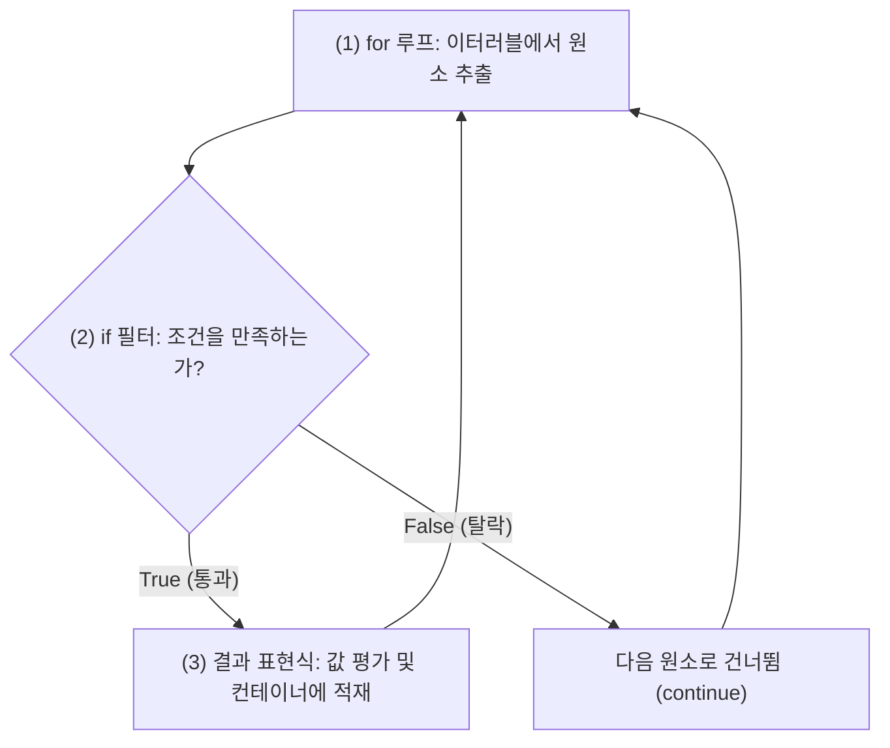

파이썬 컴프리헨션(Comprehension)은 코드를 한 줄로 간결하게 줄여주는 유용한 문법이다. 하지만 코드를 왼쪽에서 오른쪽으로 읽는 순서와 파이썬 인터프리터가 실제로 코드를 실행하는 순서가 달라서, 코드가 조금만 복잡해져도 바로 읽히지 않는 경우가 많다.

특히 복잡한 도메인 객체를 다루는 코드에서 `getattr`이나 삼항 연산자(`if-else`), 중첩 세트(Set)가 한데 얽히면 어디에 `if`가 붙어야 하고 무엇이 먼저 실행되는지 헷갈리기 쉽다. 실제 프로젝트 코드를 분석하면서 눈에 걸렸던 5가지 패턴을 일반 `for`문으로 풀어보고, 인터프리터의 실행 순서와 작성 시 주의할 점을 단계별로 정리했다.

---

## 1. 컴프리헨션의 실제 실행 순서

컴프리헨션이 한눈에 들어오지 않는 이유는 작성하는 순서와 파이썬이 평가하는 순서가 반대이기 때문이다.

```python
[ 결과_표현식   for 변수 in 이터러블   if 필터_조건 ]
  └─ (3) 최종 수집  └─ (1) 바깥 루프      └─ (2) 조건 검사
```

### 파이썬 인터프리터의 실행 순서

파이썬 인터프리터는 괄호 안의 코드를 왼쪽부터 차례대로 실행하지 않는다. 일반적인 들여쓰기 기반의 중첩 제어문과 동일하게 바깥쪽 루프부터 안쪽으로 실행한다.



1. **(1) 반복 (`for ... in ...`)**: 이터러블 객체에서 원소를 하나씩 꺼내 변수에 바인딩한다.
2. **(2) 검사 (`if ...`)**: 꺼낸 원소가 조건식을 만족하는지 검사한다. 거짓이면 아무 작업도 하지 않고 다음 원소로 넘어간다(`continue`).
3. **(3) 적재 (`결과 표현식`)**: 조건을 통과한 원소에 대해서만 맨 앞의 표현식을 평가하여 리스트, 세트, 또는 딕셔너리에 담는다.

일반 `for` 루프에서 매번 `list.append()` 함수를 호출하는 것에 비해, 컴프리헨션은 CPython 내부의 전용 바이트코드(`LIST_APPEND`, `MAP_ADD`)를 사용하므로 함수 호출 비용 없이 C 수준에서 빠르게 컨테이너를 생성한다.

---

## 2. 단순 매핑과 인덱싱 딕셔너리

목록 데이터를 순회하면서 고유 ID를 키로 삼는 딕셔너리를 만드는 패턴이다.

```python
assertions = {item.id: item for item in table.assertions}
```

### 일반 for문으로 풀어쓴 코드
```python
assertions = {}
for item in table.assertions:
    key = item.id
    val = item
    assertions[key] = val
```

### 동작 원리와 주의할 점

이 코드는 목록(`table.assertions`)을 순회하며 각 객체의 `item.id`를 키(Key)로, 객체 자체(`item`)를 값(Value)으로 매핑한다. 목록 전체를 매번 선형 탐색($O(N)$)하지 않고, 특정 ID의 객체를 $O(1)$로 빠르게 조회하기 위한 룩업 딕셔너리를 만들 때 자주 사용된다.

이 패턴에서 주의할 점은 **키 중복**이다. 파이썬 딕셔너리는 이미 존재하는 키에 새로운 값을 넣으면 에러를 발생시키지 않고 기존 값을 덮어쓴다(Last Write Wins). 만약 원본 데이터에 실수로 동일한 `item.id`를 가진 객체가 중복으로 포함되어 있다면, 뒤에 나온 객체가 앞선 객체를 조용히 덮어써서 데이터가 유실된다.

따라서 ID의 고유성이 보장되지 않는 데이터라면 컴프리헨션 전후에 길이가 같은지 확인하거나, 중복이 허용되는 경우 값을 리스트로 모아주는 `collections.defaultdict(list)`를 사용하는 것이 안전하다.

```python
# ID 중복 유입으로 인한 데이터 유실 감지
assertions = {item.id: item for item in table.assertions}
if len(assertions) != len(table.assertions):
    raise ValueError("중복된 ID가 존재하여 데이터가 유실되었습니다.")
```

---

## 3. 조건 필터와 if문의 위치 규칙

특정 객체의 여러 필드 중 상태가 모호한(`"ambiguous"`) 필드 목록만 추려내는 패턴이다.

```python
unresolved_roles = [
    field for field in ROLE_FIELDS 
    if getattr(assertion, field).status == "ambiguous"
]
```

### 일반 for문으로 풀어쓴 코드
```python
unresolved_roles = []
for field in ROLE_FIELDS:
    target_attr = getattr(assertion, field)
    if target_attr.status == "ambiguous":
        unresolved_roles.append(field)
```

### 동작 원리와 주의할 점

`ROLE_FIELDS = ["subject", "predicate", "object"]`처럼 필드명이 문자열 변수에 담겨 순회할 때는 점 표기법(`assertion.field`)을 쓸 수 없다. 대신 `getattr(assertion, field)`라는 내장 함수를 사용해 동적으로 속성 객체를 꺼낸 뒤 그 객체의 `status` 값을 비교한다.

이 코드에서 주의할 점은 크게 두 가지다.

첫째, **`for`문 뒤에 붙는 `if`는 필터 가드(Filter Guard)**다. 꺼낸 원소를 리스트에 넣을지 말지 결정하는 조건문이므로 `else`를 붙일 수 없다(`else`를 적으면 `SyntaxError`가 발생한다). 조건이 참인 원소만 최종 리스트에 남는다.

둘째, **`NoneType` 속성 참조 에러**다. 만약 `assertion` 객체에 해당 필드가 없거나 속성값이 `None`인 경우, `getattr`은 `None`을 반환한다. 그 상태에서 뒤이어 `.status`를 호출하면 `AttributeError: 'NoneType' object has no attribute 'status'`가 발생하며 전체 프로세스가 중단된다.

따라서 속성값이 비어있을 가능성이 있다면 단락 평가나 바다코끼리 연산자(`:=`)를 사용해 `None` 여부를 먼저 확인하는 방어 코드가 필요하다.

```python
# None 반환에 대비한 안전한 속성 접근
unresolved_roles = [
    field for field in ROLE_FIELDS
    if (role := getattr(assertion, field, None)) is not None 
    and getattr(role, "status", None) == "ambiguous"
]
```

---

## 4. 메서드 호출과 객체 복제 패턴

기존 리스트의 객체들을 새 리스트에 담으면서 각 객체를 독립된 메모리 공간에 복제하는 패턴이다.

```python
row.evidence = [
    anchor.evidence.model_copy(deep=True) 
    for anchor in assertion.evidence
]
```

### 일반 for문으로 풀어쓴 코드
```python
copied_evidence = []
for anchor in assertion.evidence:
    copied_model = anchor.evidence.model_copy(deep=True)
    copied_evidence.append(copied_model)
row.evidence = copied_evidence
```

### 동작 원리와 주의할 점

파이썬의 변수 대입은 객체 자체가 아니라 메모리 주소(참조)를 복사한다. 만약 복제 과정 없이 `anchor.evidence`를 새 리스트에 그대로 담으면, 나중에 `row.evidence`에 담긴 객체의 내부 값을 수정했을 때 원본인 `assertion.evidence`의 값까지 함께 바뀌어버리는 의도치 않은 상태 오염이 발생한다.

이 때문에 Pydantic의 `model_copy(deep=True)`를 호출하여 객체 내부의 중첩 리스트나 딕셔너리까지 완전히 새로운 메모리 주소로 복제한 뒤 새 리스트에 담는 것이다.

주의할 점은 복사의 깊이다. `deep=False`(기본값)로 얕은 복사를 하면 겉껍질 모델 인스턴스만 복제되고 내부의 가변 속성들은 여전히 원본과 참조를 공유한다. 따라서 내부 컨테이너가 변경될 여지가 있다면 `deep=True`를 명시해야 한다. 반대로 변경될 일이 없는 단순 불변 데이터에 무분별하게 깊은 복사를 남발하면 메모리 할당 오버헤드가 커지므로 데이터의 가변성에 맞춰 복사 수준을 정해야 한다.

---

## 5. 제너레이터 표현식과 조기 종료

데이터 목록의 유효성을 검사할 때, 2,000자가 넘는 긴 텍스트 단위가 하나라도 있는지 확인하는 패턴이다.

```python
if not (1 <= len(units) <= MAX_UNITS) or any(len(u.text) > 2000 for u in units):
    raise fail("EXTRACTION_UNIT_LIMIT")
```

### 일반 for문으로 풀어쓴 코드
```python
# any()의 동작을 일반 루프로 분해
has_oversized_unit = False
for u in units:
    if len(u.text) > 2000:
        has_oversized_unit = True
        break  # 조건 만족 원소를 발견하는 즉시 검사 중단

if not (1 <= len(units) <= MAX_UNITS) or has_oversized_unit:
    raise fail("EXTRACTION_UNIT_LIMIT")
```

### 동작 원리와 주의할 점

여기서 핵심은 `any()` 괄호 안에 대괄호 `[]`가 없다는 점이다. 대괄호 없이 작성하면 리스트 컴프리헨션이 아니라 **제너레이터 표현식(Generator Expression)**으로 동작한다.

만약 습관적으로 `any([len(u.text) > 2000 for u in units])`처럼 대괄호를 넣으면, 파이썬은 10,000개의 유닛이 있을 때 10,000개 유닛의 길이를 전부 계산해 임시 리스트를 메모리에 만든 뒤에야 `any` 검사를 시작한다.

반면 대괄호가 없는 제너레이터 표현식은 원소를 하나씩 필요할 때만 계산한다(지연 평가). 따라서 첫 번째 유닛이 2,000자를 넘는다면 나머지 9,999개는 계산하지 않고 즉시 루프를 빠져나와 `True`를 반환한다(Short-circuit / 조기 종료). 데이터 양이 많을수록 메모리와 실행 시간 차이가 크므로, 단일 조건 검사 함수에 전달할 때는 대괄호를 생략하는 것이 원칙이다.

---

## 6. 삼항 연산자와 중첩 컴프리헨션

필드 상태가 `"explicit"`이면 후보군 참조 세트(Set)를 만들어 넣고, 그렇지 않으면 빈 세트(`set()`)를 채워 넣는 딕셔너리 생성 패턴이다.

```python
explicit = {
    field: {
        mention.candidate_ref
        for mention in getattr(assertion, field).mentions
        if mention.candidate_ref is not None
    }
    if getattr(assertion, field).status == "explicit"
    else set()
    for field in ROLE_FIELDS
}
```

### 3단계 레이어로 나누어 보기

이 코드가 복잡해 보이는 이유는 딕셔너리 컴프리헨션 안에 삼항 연산자와 세트 컴프리헨션이 한꺼번에 들어있기 때문이다. 바깥쪽부터 3단계로 나누어 보면 구조가 단순해진다:

```text
[1단계: 바깥 딕셔너리 골격]
{ field: <값_표현식> for field in ROLE_FIELDS }

[2단계: 값을 결정하는 삼항 연산자 (if-else)]
<세트_결과> if status == "explicit" else set()

[3단계: 참일 때 실행되는 안쪽 세트 컴프리헨션]
{ mention.candidate_ref for mention in ... if mention.candidate_ref is not None }
```

### 일반 for문으로 풀어쓴 코드
```python
explicit = {}

# 1단계: 역할 필드 순회
for field in ROLE_FIELDS:
    field_obj = getattr(assertion, field)
    
    # 2단계: 삼항 연산자의 조건 분기
    if field_obj.status == "explicit":
        # 3단계: 안쪽 세트 생성 및 None 필터링
        candidate_set = set()
        for mention in field_obj.mentions:
            if mention.candidate_ref is not None:
                candidate_set.add(mention.candidate_ref)
        explicit[field] = candidate_set
    else:
        explicit[field] = set()
```

### 동작 원리와 주의할 점

이 코드는 `KeyError`를 방지하기 위해 분석 대상이 아닌 필드에도 빈 세트(`set()`)를 일관되게 초기화하면서, 대상 필드에 대해서는 `None`을 제외한 고유 식별자 세트를 구성한다.

이 패턴을 작성할 때 가장 흔히 범하는 문법 실수는 **콜론(`:`)의 중복 사용**이다.
딕셔너리 컴프리헨션에서 콜론은 Key와 Value를 나누는 기호이므로 맨 앞의 `field:` 자리에 딱 한 번만 써야 한다. 콜론 뒤의 Value 자리에 삼항 연산자 전체(`A if 조건 else B`)가 하나의 표현식으로 쏙 들어가야 한다.

```python
# 흔히 발생하는 문법 에러 (SyntaxError)
explicit = {
    field: set(...) if 조건 else field: set()   # ❌ else 뒤에 콜론 중복
    for field in ROLE_FIELDS
}

# 올바른 구조
explicit = {
    field: (set(...) if 조건 else set())       # ⭕ Value 자리에 삼항 연산자 배치
    for field in ROLE_FIELDS
}
```

또한 `else` 절에서 기본값을 채울 때 전역 상수로 정의된 빈 세트(`DEFAULT_SET = set()`)를 재사용하면 여러 필드가 동일한 세트 인스턴스를 공유하게 되어, 나중에 한 필드에 값을 추가할 때 다른 필드까지 오염되는 버그가 발생한다. 반드시 `else set()`처럼 매번 새로운 인스턴스를 생성해야 한다.

마지막으로 컴프리헨션이 3단계 이상 중첩되면 동료 개발자가 코드를 읽을 때 큰 인지 부하를 겪게 된다. 안쪽 세트 추출 로직이 조금이라도 더 길어진다면 억지로 한 줄로 작성하기보다 독립된 함수(`extract_candidates(field_obj)`)로 분리하는 것이 훨씬 유지보수하기 좋다.

---

## 7. 정리

컴프리헨션 문법을 작성할 때 기억할 핵심 기준은 세 가지다:

1. **실행 순서**: 코드는 왼쪽에서 오른쪽으로 작성하지만, 파이썬은 `for 루프` ➔ `if 필터 검사` ➔ `결과 표현식 평가` 순서로 실행한다.
2. **`if`의 위치와 역할**:
   - `for` 뒤의 단독 `if`: 원소를 포함할지 버릴지 결정하는 **필터** (`else` 불가, 원소 수 감소).
   - `for` 앞의 `if-else`: 결과 값으로 무엇을 넣을지 결정하는 **삼항 연산자** (`else` 필수, 원소 수 유지).
3. **안전한 작성 습관**:
   - 딕셔너리 컴프리헨션에 삼항 연산자를 결합할 때는 콜론(`:`)을 맨 앞에 한 번만 작성하고 Value 자리에 분기식을 넣는다.
   - 대규모 데이터 검증 함수에는 대괄호를 생략한 제너레이터 표현식을 넘겨 조기 종료 효율을 얻는다.
   - 가변 객체를 다룰 때는 깊은 복사와 독립 인스턴스 생성을 통해 의도치 않은 참조 공유를 방지한다.
