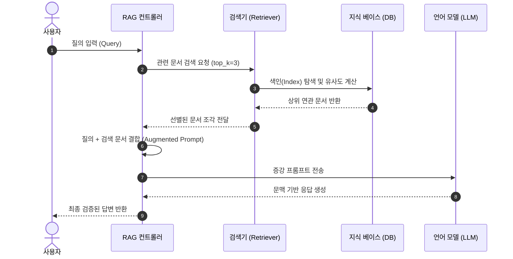

## 1. 사전학습 LLM의 한계

대규모 언어 모델(LLM)의 파라미터 가중치는 사전 학습(Pre-training)이 완료되는 시점에 고정된다. 따라서 모델은 학습 데이터에 포함된 일반적인 지식은 자연스럽게 처리하지만, 학습 시점 이후에 발생한 실시간 이벤트나 조직 내부의 비공개 데이터에 대해서는 신뢰할 수 있는 정보를 제공하지 못한다.

예를 들어 "주말에 호텔 요금이 평일보다 비싼 이유가 무엇인가?"라는 일반적인 질문에는 수요와 공급의 원리를 기반으로 정상적인 답변을 생성할 수 있다. 하지만 "이번 주말 밴쿠버 시내 호텔 요금이 급격히 상승한 구체적 원인은 무엇인가?"처럼 특정 시점의 외부 이벤트(대형 콘서트 투어 등)가 결합된 질문이나, "밴쿠버 도심 인근 호텔 수용량이 구조적으로 제한된 도시계획 조닝(Zoning) 법규의 배경은 무엇인가?"와 같은 특수 도메인 행정 문서는 학습 코퍼스 내에 존재하지 않는다. 새로운 정보가 유입될 때마다 수십억에서 수천억 개에 달하는 모델 파라미터 전체를 다시 학습(Retraining)하거나 파인튜닝하는 방식은 막대한 연산 자원과 시간이 소모된다. 모델 가중치를 갱신하려면 수억 원의 연산 비용과 수일 이상의 재학습 시간이 필요하다. 반면 RAG 구조에서는 지식 베이스 데이터베이스의 특정 행을 수정하는 것만으로 밀리초 단위에 최신 정보를 즉시 반영할 수 있다.

언어 모델이 학습되지 않은 정보에 대해 모른다고 응답하지 못하고 잘못된 정보를 생성하는 이유는 모델의 근본적인 텍스트 생성 방식에 기인한다. 언어 모델은 주어진 문장의 사실 여부를 판별하는 검증기가 아니라, 앞서 입력된 토큰 시퀀스 뒤에 올 가장 그럴듯한 다음 토큰을 확률적으로 계산하는 자기회귀(Autoregressive) 확률 모델이다. 수만에서 수십만 개의 어휘 사전($V$)에 대해 이전 토큰 조건부 확률 $P(w_t \mid w_{<t})$을 산출하고, 이 확률 분포에서 다음 토큰을 순차적으로 샘플링한다. 예를 들어 `"What a beautiful day, the sun is"`라는 미완성 문장이 주어지면, 모델은 어휘 사전을 탐색하여 `shining`(80%), `rising`(5%), `exploding`(0.00002%)과 같이 각 단어가 등장할 확률을 계산한 뒤 가장 통계적으로 유력한 단어를 선택한다. 따라서 최신 사실이나 사내 문서에 대한 정보가 가중치에 없더라도, 모델은 텍스트 생성을 중단하는 대신 학습된 언어 통계 구조에 따라 문법적으로 그럴듯한 단어 연쇄를 조합해 출력하며, 이것이 바로 환각(Hallucination)이 발생하는 동작 원리다.

```text
[ 일반적인 LLM 사용 방식 ]
사용자 입력(Prompt) ───────────────────────────▶ LLM ───▶ 응답(Response)
                                                ▲
                                                │ (가중치 내 정보만 참조 ➔ 최신/비공개 데이터 환각 발생)

[ RAG 파이프라인 구조 ]
사용자 입력(Query) ──▶ 검색기(Retriever) ──▶ 증강 프롬프트(Augmented Prompt) ──▶ LLM ───▶ 검증된 응답
                           │                         ▲
                           ▼                         │
                    지식 베이스(Knowledge Base) ───────┘ (검색된 관련 문서 주입)
```

이러한 한계를 극복하기 위해 모델의 가중치를 직접 수정하는 대신, 질문을 처리하는 시점에 필요한 외부 문맥을 프롬프트 안에 직접 주입하는 프롬프트 접지(Grounding) 방식이 고안되었다. 이것이 검색 증강 생성(Retrieval-Augmented Generation, RAG)의 핵심 개념이다. RAG 시스템은 언어 모델 앞단에 신뢰할 수 있는 사내 문서나 최신 데이터를 보관하는 지식 베이스(Knowledge Base), 그리고 사용자의 질문과 관련된 문서를 찾아내는 검색기(Retriever)를 배치한다. 사용자의 질의가 입력되면 검색기가 지식 베이스에서 관련 문서들을 먼저 탐색하고, 추출된 문서 내용을 원본 질의와 결합하여 증강 프롬프트(Augmented Prompt)를 조립한 뒤 언어 모델에 전달한다. 언어 모델은 가중치에 없는 내용이라도 프롬프트에 제공된 문맥을 바탕으로 사실에 부합하는 응답을 생성하게 된다.


여기서 "그렇다면 지식 베이스에 있는 문서 전체를 프롬프트에 한 번에 넣으면 되지 않는가?"라는 질문이 생길 수 있다. 하지만 트랜스포머 디코더의 연산 구조상 무제한으로 문맥을 주입하는 것은 불가능하다. 언어 모델은 답변 토큰을 1개 출력할 때마다 프롬프트의 모든 토큰과 이미 생성된 이전 토큰 전체를 대상으로 Self-Attention 연산을 반복 수행한다. 입력 프롬프트의 길이가 $N$이고 답변으로 생성할 토큰 수가 $M$이라면, 모델은 토큰을 하나 생성할 때마다 $N, N+1, N+2, \dots, N+M-1$개의 이전 토큰 벡터와 내적(Dot-product)을 계산하여 어텐션 가중치를 갱신해야 한다. 

따라서 수만 자에 달하는 사내 문서 전체를 프롬프트에 그대로 넣어서 $N$이 비대해지면, 토큰 1개를 계산할 때마다 처리해야 하는 행렬 연산량과 Key-Value(KV) 캐시 메모리 점유율이 급증한다. 이는 첫 토큰 응답 시간(Time to First Token, TTFT)을 늦추고 전체 생성 지연 시간(Latency)을 크게 증가시키며, 입력 토큰 수에 비례하는 API 호출 비용을 발생시킨다. 또한 모델마다 처리 가능한 최대 입력 한계인 문맥 창(Context Window) 규격이 정해져 있을 뿐만 아니라, 프롬프트 길이가 지나치게 길어지면 문맥의 중간 부분에 위치한 핵심 사실을 모델이 간과하는 중간 손실(Lost in the Middle) 현상도 나타난다. 결국 데이터베이스 전체를 무작정 전달하는 대신, 질의와 직접적으로 연관된 소수의 핵심 문서 조각만 정밀하게 선별해 프롬프트에 공급하는 고성능 검색기(Retriever)의 설계가 RAG 파이프라인의 필수 요구조건이 된다.

---

## 2. 검색기 결합과 데이터 흐름

사용자 인터페이스 관점에서 RAG 시스템은 질문을 입력하고 답변을 돌려받는 일반적인 LLM 호출과 동일하게 보인다. 하지만 시스템 내부에서는 단순 호출을 넘어 **질의 수신 ➔ 지식 베이스 검색 ➔ 증강 프롬프트 조립 ➔ 모델 추론**으로 이어지는 4단계 데이터 파이프라인이 순차적으로 실행된다.



검색기의 핵심 역할은 지식 베이스에 축적된 수많은 문서 중 현재 질의를 해결하는 데 실질적으로 기여하는 문서만 걸러내는 것이다. 검색기는 사전에 색인(Index)된 문서 집합을 대상으로 질의 텍스트와의 연관성을 수치화한 유사도 점수(Similarity Score)를 계산하고, 점수가 높은 순서대로 문서를 정렬한다. 이때 몇 개의 문서를 프롬프트에 넘길 것인가(`top_k`)를 결정하는 과정에는 명확한 공학적 트레이드오프가 존재한다. 반환 문서 수($k$)를 과도하게 늘리면 앞서 살펴본 문맥 창 낭비와 연산 지연, 그리고 질의와 무관한 노이즈 문장이 주입되어 생성 품질이 저하된다. 반대로 $k$를 1개로 지나치게 좁히면 2~3순위에 포함된 결정적인 세부 근거를 놓쳐 불완전한 응답이 생성될 위험이 커진다.

이러한 검색과 생성의 결합 구조를 가장 단순한 파이썬 코드로 표현하면 세 단계 함수 호출 체인으로 나타낼 수 있다.

```python
def rag_pipeline(query: str, top_k: int = 3) -> str:
    # 1. 지식 베이스에서 질의와 연관성이 높은 문서 검색
    retrieved_docs = retrieve(query, top_k=top_k)

    # 2. 검색된 문서와 사용자 질의를 결합하여 증강 프롬프트 조립
    context_text = "\n".join(retrieved_docs)
    augmented_prompt = (
        f"다음 제공된 문맥을 바탕으로 질문에 사실에 입각하여 답하라.\n\n"
        f"[참고 문맥]\n{context_text}\n\n"
        f"[사용자 질문]\n{query}"
    )

    # 3. 문맥이 주입된 완성 프롬프트를 언어 모델에 전달하여 응답 생성
    response = generate(augmented_prompt)
    return response
```

`retrieve()` 함수는 지식 베이스를 탐색해 질의와 가장 연관도가 높은 $k$개의 텍스트 조각을 리스트 형태로 반환한다. 컨트롤러 계층에서는 이 문서들을 줄바꿈(`\n`)으로 연결해 명시적인 문맥 구분자(`[참고 문맥]`) 안에 배치하고, 원본 질의와 결합하여 단일 프롬프트 문자열로 완성한다. 마지막으로 `generate()` 함수가 완성된 프롬프트를 언어 모델의 API 엔드포인트로 전송한다. 이처럼 검색기가 사실 확인과 데이터 필터링을 전담함으로써, 언어 모델은 방대한 데이터 속에서 정보를 찾아 헤매는 대신 주어진 문맥을 논리적으로 종합해 자연스러운 문장으로 서술하는 본래 역할에 집중할 수 있다.

---

## 3. 증강 프롬프트 조립과 스키마

지식 베이스나 데이터베이스에서 검색된 결과는 대개 파이썬 딕셔너리(`dict`)나 테이블의 레코드 형태를 띤다. 이 원시 객체를 `str(dict)` 형태로 프롬프트에 그대로 넣으면 문제가 발생한다. 중괄호와 따옴표 같은 구문 기호가 불필요하게 토큰을 소비한다. 또한 필드 경계가 불명확해 모델이 수치나 속성을 혼동하기 쉽다. 따라서 모델이 읽기 편한 자연어 문장 구조로 데이터를 변환해야 한다.

실습 환경에서는 부동산 매물 딕셔너리 데이터를 예시로 사용한다. 아래 코드는 원시 레코드를 서술형 문장으로 가공하고, 이를 프롬프트 템플릿에 결합하는 과정을 보여준다.

```python
# 1. 딕셔너리 데이터를 읽기 쉬운 문장 레이아웃으로 변환
def house_info_layout(houses: list[dict]) -> str:
    layout = ""
    for house in houses:
        layout += (
            f"House located at {house['address']}, {house['city']}, {house['state']} {house['zip']} with "
            f"{house['bedrooms']} bedrooms, {house['bathrooms']} bathrooms, "
            f"{house['square_feet']} sq ft area, priced at ${house['price']}, "
            f"built in {house['year_built']}.\n"
        )
    return layout

# 2. 지시문, 문맥 데이터, 질문을 결합한 증강 프롬프트 생성
def generate_prompt(query: str, houses: list[dict]) -> str:
    houses_layout = house_info_layout(houses)
    prompt = f"""Use the following houses information to answer users queries.
{houses_layout}
Query: {query}"""
    return prompt
```

`house_info_layout()` 함수는 매물 딕셔너리를 순회하며 주소, 방 개수, 면적, 가격 정보를 한 줄의 설명 문장으로 정리한다. 각 매물 정보는 줄바꿈(`\n`)으로 구분하여 모델이 개별 레코드를 독립된 단위로 인식하게 만든다. `generate_prompt()` 함수는 이 가공된 텍스트(`houses_layout`)를 지시문 아래에 배치하고 맨 마지막에 사용자의 `Query`를 덧붙인다. 지시문과 문맥, 질문이 명확한 구획으로 나뉘어 있어 모델이 어떤 데이터를 참고해 무엇에 답해야 하는지 직관적으로 파악할 수 있다.

이렇게 문맥을 주입했을 때와 주입하지 않았을 때의 모델 출력 차이는 분명하다. "가장 비싼 집과 가장 넓은 집은 어디인가?"라는 질문을 단독으로 보냈을 때, 모델은 해당 매물에 대한 정보가 없으므로 집을 고르는 일반적인 기준만 장황하게 설명한다. 반면 가공된 매물 문맥을 함께 전달하면, 모델은 Shelbyville 소재 주택(\$320,000, 2,500 sq ft)과 Springfield 소재 주택(\$230,000, 1,500 sq ft)의 수치를 정확히 비교해 단번에 정답을 찾아낸다. 정형화된 프롬프트 템플릿으로 데이터를 주입하는 작업이 모델의 환각을 방어하는 기초적인 안전장치가 된다.

---

## 4. 뉴스 데이터 기반 파이프라인

### 벡터 유사도 검색과 기사 조회 내부 구조

단순 텍스트 매칭만으로는 질문의 의도와 문서의 의미적 연관성을 정밀하게 파악하기 어렵다. 따라서 현대 검색기는 문장을 고차원 수치 벡터로 변환하는 임베딩 모델과 벡터 간 유사도 연산을 활용한다.

실습 환경에서는 2024년 뉴스 데이터셋(`news_data_dedup.csv`)을 지식 베이스로 사용한다. 아래 코드는 질문 임베딩 생성부터 코사인 유사도 계산, 그리고 상위 문서 인출까지의 실제 내부 구현이다.

```python
import numpy as np
from sentence_transformers import SentenceTransformer
from sklearn.metrics.pairwise import cosine_similarity

# 1. 질문 임베딩 생성과 코사인 유사도 기반 인덱스 추출
def retrieve(query: str, top_k: int = 5) -> np.ndarray:
    # 질문 텍스트를 768차원 밀집 벡터로 변환
    query_embedding = model.encode(query)

    # 사전 계산된 기사 임베딩 행렬과 코사인 유사도 일괄 계산
    similarity_scores = cosine_similarity(query_embedding.reshape(1, -1), EMBEDDINGS)[0]

    # 유사도 점수 내림차순으로 원본 기사 행 인덱스 정렬
    similarity_indices = np.argsort(-similarity_scores)
    top_k_indices = similarity_indices[:top_k]

    return top_k_indices

# 2. 인덱스 리스트를 받아 실제 뉴스 기사 레코드 인출
def query_news(indices: list[int]) -> list[dict]:
    output = [NEWS_DATA[index] for index in indices]
    return output

# 3. 검색과 조회를 하나로 결합한 파이프라인 함수
def get_relevant_data(query: str, top_k: int = 5) -> list[dict]:
    relevant_indices = retrieve(query=query, top_k=top_k)
    relevant_data = query_news(relevant_indices)
    return relevant_data
```

`model.encode()`는 BGE-base 모델을 사용해 가변 길이의 질문 텍스트를 768차원의 밀집 벡터(Dense Vector)로 압축 변환한다. 이 벡터와 사전 계산된 전체 기사 임베딩 행렬(`EMBEDDINGS`)을 `cosine_similarity()`에 전달하여 유사도 점수를 구한다.

기하학에서 두 점 사이의 최단 직선 거리를 재는 유클리드 거리(Euclidean Distance)는 값의 절대적 차이를 비교한다. 하지만 수백에서 수천 차원에 달하는 고차원 공간에서는 모든 점 사이의 거리가 멀어져 거리의 변별력이 약해진다. 또한 문서의 길이나 단어 수에 따라 벡터의 물리적 크기가 왜곡된다. 따라서 값의 크기 대신 두 벡터가 가리키는 **방향(Angle)**의 일치도를 측정하기 위해 코사인 유사도를 사용한다. 예를 들어 $[10, 10]$과 $[100, 100]$은 크기가 다르지만 가리키는 방향이 같으므로 의미적으로 동일한 주제로 판단할 수 있다.

코사인 유사도는 두 벡터 $u$와 $v$ 사이의 사잇각 코사인 값을 측정하는 지표다. 수식으로는 두 벡터의 내적을 각 벡터의 L2 노름(크기) 곱으로 나눈 값이다.

$$\text{Cosine Similarity}(u, v) = \frac{u \cdot v}{\|u\|_2 \|v\|_2}$$

넘파이로 표현하면 `np.dot(u, v) / (np.linalg.norm(u) * np.linalg.norm(v))`와 같다. 두 벡터의 방향이 완전히 일치하면 1, 직교하면 0, 반대 방향이면 -1을 가진다.

유사도 점수가 계산되면 `np.argsort(-similarity_scores)`를 실행한다. 점수 배열 자체를 정렬하면 점수 값만 남고 어떤 기사의 점수인지 알 수 없다. 따라서 값의 내림차순 순서를 유지하면서 해당 원소의 원래 위치(행 번호)를 배열로 반환하는 `argsort`를 사용한다. 상위 `top_k`개의 인덱스를 슬라이싱한 뒤, `query_news()`가 리스트 컴프리헨션으로 메모리에 로드된 기사 딕셔너리를 즉시 추출한다. `get_relevant_data()`는 이 두 함수를 결합해 질문에 대응하는 최적의 기사 레코드 목록을 반환한다.

### 검색 기사 정리와 프롬프트 조립

검색된 기사 레코드는 제목, 본문 요약, 발행일, 출처 URL 필드를 포함하는 딕셔너리 구조다. 모델이 문맥을 정확히 파악할 수 있도록 각 속성을 명확한 줄바꿈 텍스트로 정리해야 한다.

또한 실제 파이프라인 운영에서는 RAG 적용 여부를 선택할 수 있어야 한다. 아래 코드는 검색된 기사들을 하나의 텍스트 블록으로 정리하고, 증강 프롬프트 템플릿과 결합하는 로직을 보여준다.

```python
# 1. 검색된 기사 딕셔너리 리스트를 줄바꿈 텍스트로 변환
def format_relevant_data(relevant_data: list[dict]) -> str:
    formatted_documents = []
    for document in relevant_data:
        formatted_document = (
            f"Title: {document['title']}, "
            f"Description: {document['description']}, "
            f"Published at: {document['published_at']}\n"
            f"URL: {document['url']}"
        )
        formatted_documents.append(formatted_document)
    return "\n".join(formatted_documents)

# 2. RAG 활성화 여부에 따른 프롬프트 분기 조립
def generate_final_prompt(query: str, top_k: int = 5, use_rag: bool = True, prompt: str = None) -> str:
    if not use_rag:
        return query

    # 상위 k개 기사 검색 및 텍스트 정리
    relevant_data = get_relevant_data(query, top_k=top_k)
    retrieve_data_formatted = format_relevant_data(relevant_data)

    if prompt is None:
        prompt = (
            f"Answer the user query below. There will be provided additional information for you to compose your answer. "
            f"The relevant information provided is from 2024 and it should be added as your overall knowledge to answer the query, "
            f"you should not rely only on this information to answer the query, but add it to your overall knowledge.\n"
            f"Query: {query}\n"
            f"2024 News: {retrieve_data_formatted}"
        )
    else:
        prompt = prompt.format(query=query, documents=retrieve_data_formatted)

    return prompt
```

`format_relevant_data()` 함수는 기사 딕셔너리에서 제목(`title`), 요약(`description`), 발행일(`published_at`), 출처(`url`)를 추출한다. 개별 기사를 한 덩어리의 문자열로 묶고 줄바꿈(`\n`)으로 구분하여 직관적인 텍스트 블록을 구성한다.

`generate_final_prompt()` 함수는 `use_rag` 플래그를 통해 파이프라인의 동작을 제어한다. `use_rag=False`인 경우 외부 검색을 건너뛰고 사용자의 원본 질의만 그대로 반환한다. 반면 `use_rag=True`이면 `get_relevant_data()`와 `format_relevant_data()`를 순차 호출해 기사 문맥을 추출한다. 기본 프롬프트 템플릿은 모델에게 제공된 문맥이 2024년 최신 정보임을 명시하고, 기존 사전학습 지식과 결합하여 질의에 답변하도록 유도한다. 발행일과 URL 메타데이터를 함께 주입하므로 모델이 시점을 오인하지 않고 근거에 기반해 답변을 생성할 수 있다.

### 모델 호출과 최신 뉴스 답변 비교

증강 프롬프트가 완성되면 이를 언어 모델 API 엔드포인트에 전달하여 최종 답변을 생성한다. 전체 파이프라인을 묶는 종단간(End-to-End) 호출 함수는 다음과 같다.

```python
# 검색, 프롬프트 조립, LLM 생성을 통합하는 종단간 파이프라인 함수
def llm_call(query: str, top_k: int = 5, use_rag: bool = True, prompt: str = None) -> str:
    # 1. 프롬프트 생성 (RAG 여부에 따라 일반 질의 또는 증강 프롬프트 반환)
    final_prompt = generate_final_prompt(query, top_k=top_k, use_rag=use_rag, prompt=prompt)

    # 2. 언어 모델 호출 (Together AI Qwen/Qwen3.5-9B)
    generated_response = generate_with_single_input(final_prompt)

    # 3. 모델이 생성한 텍스트 응답 추출
    generated_message = generated_response['content']
    return generated_message
```

`llm_call()` 함수는 앞서 구현한 `generate_final_prompt()`를 호출해 완성된 프롬프트를 얻는다. 이어 `generate_with_single_input()`을 통해 Together AI의 Qwen 9B 모델 API로 프롬프트를 전송하고 생성 결과를 반환한다.

이 파이프라인에 최신 경제 질의인 `"Tell me about the US GDP in the past 3 years."`(최근 3년간 미국 GDP 현황에 대해 알려달라)를 입력하여 RAG 적용 여부에 따른 출력 차이를 비교한다.

먼저 RAG를 적용하지 않은 경우(`use_rag=False`), 모델은 사전 학습 데이터에 포함된 2021~2023년 과거 지식만 참조한다. 2024년 1분기 경제 성장률이나 최신 IMF 전망치는 알지 못하므로, 과거 일반론을 서술하거나 최근 상황에 대해 불확실한 추측을 내놓는다.

반면 RAG를 적용한 경우(`use_rag=True`), 검색기는 2024년 4월 월스트리트저널(WSJ) 기사들을 프롬프트에 주입한다. 검색된 기사에는 "올해 미국이 전 세계 GDP의 26.3%를 차지해 20년 만에 최고치를 기록할 것이라는 IMF 전망"과 "2024년 1분기 미국 GDP 성장률이 연율 1.6%로 집계되었다"는 최신 수치가 담겨 있다. 모델은 주입된 문맥을 바탕으로 2024년 4월 시점의 구체적인 경제 지표와 수치를 인용한 정확한 답변을 생성한다.

이처럼 검색기를 결합한 RAG 아키텍처는 모델의 고정된 사전학습 가중치를 재학습하지 않고도, 외부 지식 베이스의 최신 사실을 프롬프트 문맥으로 실시간 공급하여 신뢰성 높은 답변을 완성한다. 또한 프롬프트에 포함된 기사 발행일과 출처 URL은 단순한 배경 정보에 그치지 않는다. 모델이 문맥을 인용해 답변할 때 출처(Citation)를 함께 명시하도록 유도할 수 있다. 이를 통해 사용자는 모델의 출력을 맹신하지 않고 원본 문서를 직접 대조하여 사실 여부를 교차 검증할 수 있다.

---

## 5. 참고 자료

1. **DeepLearning.AI & Coursera** — *Retrieval Augmented Generation (RAG)* Specialization, Course 1: "Introduction to RAG Systems" (Instructor: Zain Hasan, Andrew Ng)
2. **BAAI** — `bge-base-en-v1.5` Dense Text Embedding Model Specifications
3. **Together AI** — Open-Source LLM Inference Platform (`Qwen/Qwen3.5-9B`)
4. **Scikit-Learn Documentation** — `sklearn.metrics.pairwise.cosine_similarity` & Vector Operations Guide
