> **연재 1편**: 도메인 구조와 공통 모듈 (`ts-common`) — 게이트웨이 보안, 철도망 스케줄링, 좌석 배정, 예매 주문 오케스트레이션으로 이어지는 8부작 중 첫 번째 글이다.

---

## 1. 시스템 개요와 규모

넷플릭스의 Eureka와 Spring Cloud, 쿠버네티스(Kubernetes)와 서비스 메시(Istio)가 널리 쓰인다. 하지만 수십 개 마이크로서비스가 맞물린 대규모 시스템의 내부 코드를 직접 확인하기는 쉽지 않다. 대다수의 입문 예제는 2\~3개의 작은 서비스만 다룬다. 그 때문에 분산 트랜잭션, 데이터 동기화 지연, 폴리글랏 퍼시스턴스, 서비스 간 의존성 복잡도 같은 실제 운영 문제를 살피기 어렵다.

이러한 구조를 학습하기 적합한 오픈소스 벤치마크가 중국 푸단대학교(Fudan University) SELab/CodeWisdom 팀이 개발한 **Train Ticket**이다.

| 구성 항목 | 규모 및 기술 스택 | 비고 |
|---|---|---|
| **마이크로서비스** | 46개 독립 서비스 (Java Spring Cloud, Go, Python, Node.js) | 비즈니스 경계 기준 7개 도메인 분할 |
| **데이터베이스** | 26개 독립 DB (MongoDB 24개 + MySQL 2개) | 서비스별 독립 저장소 분리 |
| **연구 활용 분야** | 분산 추적, AIOps, 장애 진단, 부하 테스트 표준 벤치마크 | 학계 및 클라우드 네이티브 실험 기준 |

Train Ticket은 대규모 인구 이동이 몰리는 **중국 춘절 기간의 철도 예매 시스템(12306.cn)**을 본떠 설계되었다. 초당 수만 건의 좌석 조회와 순간적인 예매 트래픽 폭증, 다구간 환승 계산, 실시간 결제와 취소 대기열 처리를 재현한다.

이번 1편에서는 전체 시스템을 이루는 **7대 도메인 위상(Topology)**과 Nacos 기반 **2단계 라우팅 구조**를 먼저 정리한다. 이어서 NoSQL과 RDBMS를 나눈 **폴리글랏 퍼시스턴스 전략**과, 46개 서비스가 함께 쓰는 공통 라이브러리 **`ts-common`의 설계 결함과 교훈**을 살펴본다.

---

## 2. 7대 도메인 아키텍처

Train Ticket은 46개의 서비스가 무질서하게 흩어져 있는 것이 아니라, 명확한 비즈니스 경계(Bounded Context)에 따라 **7대 도메인**으로 정교하게 분할되어 있다.

```mermaid
flowchart TD
    subgraph Ingress ["1. 관문 & 보안 도메인 (Gateway & Auth)"]
        UI["ts-ui-dashboard (Frontend/Node)"]
        GW["ts-gateway-service (Spring Cloud Gateway :18888)"]
        AUTH["ts-auth-service (JWT Auth/RBAC)"]
        USER["ts-user-service"]
        CONTACTS["ts-contacts-service"]
        SEC["ts-security-service"]
        VCODE["ts-verification-code-service"]
        AVATAR["ts-avatar-service"]
    end

    subgraph TravelDomain ["2. 철도망 & 스케줄링 도메인 (Travel & Route)"]
        TRAVEL["ts-travel-service (고속철 G/D)"]
        TRAVEL2["ts-travel2-service (일반열차 K/T/Z)"]
        TRAIN["ts-train-service"]
        ROUTE["ts-route-service"]
        STATION["ts-station-service"]
        ROUTE_PLAN["ts-route-plan-service"]
        TRAVEL_PLAN["ts-travel-plan-service"]
        OFFICE["ts-ticket-office-service (Go)"]
    end

    subgraph SeatPrice ["3. 좌석 & 요금 산정 도메인 (Seat & Price)"]
        SEAT["ts-seat-service (Stateless 메모리 배정)"]
        BASIC["ts-basic-service (Facade 집계)"]
        TICKETINFO["ts-ticketinfo-service"]
        PRICE["ts-price-service"]
        CONFIG["ts-config-service"]
    end

    subgraph OrderPreserve ["4. 예매 & 주문 도메인 (Preserve & Order)"]
        PRESERVE["ts-preserve-service (Saga 오케스트레이터)"]
        PRESERVE_OTHER["ts-preserve-other-service"]
        ORDER["ts-order-service (고속철 주문 DB)"]
        ORDER_OTHER["ts-order-other-service (일반 주문 DB)"]
        WAIT["ts-wait-order-service (취소표 대기열)"]
        CANCEL["ts-cancel-service"]
        REBOOK["ts-rebook-service"]
        EXEC["ts-execute-service (검표/개찰)"]
    end

    subgraph PaymentValue ["5. 결제 & 부가 생태계 도메인 (Payment & Value-Added)"]
        PAY["ts-inside-payment-service / ts-payment-service"]
        VOUCHER["ts-voucher-service (MySQL 영수증)"]
        FOOD["ts-food-service / ts-food-map-service"]
        ST_FOOD["ts-station-food-service / ts-train-food-service"]
        DELIVERY["ts-delivery-service / ts-food-delivery-service"]
        ASSURANCE["ts-assurance-service"]
        CONSIGN["ts-consign-service / ts-consign-price-service"]
        NOTIFY["ts-notification-service"]
        NEWS["ts-news-service (Node.js)"]
    end

    subgraph AdminDomain ["6. 관리자 운영 도메인 (Admin Backoffice)"]
        ADM_USER["ts-admin-user-service"]
        ADM_ORDER["ts-admin-order-service"]
        ADM_BASIC["ts-admin-basic-info-service"]
        ADM_ROUTE["ts-admin-route-service"]
        ADM_TRAVEL["ts-admin-travel-service"]
    end

    subgraph InfraMesh ["7. 인프라 & 관측성 도메인 (Infra & Mesh)"]
        NACOS["Nacos (Service Discovery & Config :8848)"]
        JAEGER["Jaeger / SkyWalking / Zipkin"]
        DBS["26개 독립 DB (MongoDB 24 + MySQL 2)"]
    end

    UI --> GW
    GW --> AUTH & TRAVEL & PRESERVE & PAY & ADM_USER
    PRESERVE --> SEAT & TRAVEL & ORDER & SEC & PAY
    GW -.-> NACOS
    TRAVEL -.-> NACOS
    PRESERVE -.-> NACOS
```



### 7대 기능 도메인 요약표

| 도메인 | 서비스 수 | 대표 서비스 | 핵심 역할 |
|---|:---:|---|---|
| **1. 관문 & 보안** | 8개 | `ts-gateway`, `ts-auth`, `ts-security` | 단일 진입점 라우팅, JWT 토큰 발급, 어뷰징/매크로 호출 차단 |
| **2. 철도망 & 스케줄** | 8개 | `ts-travel`, `ts-travel2`, `ts-route` | 고속철/일반열차 분리 운영, 정차역 및 스케줄, 다익스트라 환승 탐색 |
| **3. 좌석 & 요금** | 5개 | `ts-seat`, `ts-price`, `ts-basic` | DB 없는 메모리 비트맵 좌석 배정, 거리와 좌석별 요금 산정 파사드 |
| **4. 예매 & 주문** | 8개 | `ts-preserve`, `ts-order`, `ts-wait-order` | 거대 분산 트랜잭션 오케스트레이션, 주문 상태 머신 관리, 매진 대기표 |
| **5. 결제 & 부가생태계**| 12개 | `ts-payment`, `ts-voucher`, `ts-food-*` | 이중 검증 결제, 회계 영수증(ACID), 차내 도시락 배달, 수하물 탁송 |
| **6. 관리자 운영망** | 5개 | `ts-admin-travel`, `ts-admin-order` | 일반 승객과 분리된 백스테이지 제어, 노선 긴급 편성 및 고객 지원 |
| **7. 인프라 & 관측성** | - | `nacos`, `jaeger`, `openebs` | 서비스 등록과 디스커버리, 분산 추적, 데이터 볼륨 영속화 |

위 표의 핵심 아키텍처 용어는 각각 다음 역할을 가리킨다.
- **파사드(Facade)**: `ts-basic-service`처럼 여러 하위 서비스(열차, 노선, 가격, 설정)의 조회 결과를 한 번에 모아 단일 응답 창구로 제공하는 패턴이다.
- **사거(Saga) 오케스트레이터**: `ts-preserve-service`처럼 여러 마이크로서비스에 걸친 예매 과정을 순차 로컬 트랜잭션으로 호출하고, 중간 실패 시 취소나 보상 요청으로 정합성을 맞추는 패턴이다.
- **메모리 비트맵 좌석 배정**: `ts-seat-service`가 DB 잠금 대신 이미 판매된 좌석 구간을 비트 배열(Bitmap)로 계산해 빈 좌석을 즉시 고르는 무상태 방식이다.

---

## 3. 2단계 라우팅 구조

46개 마이크로서비스가 맞물려 돌아가는 환경에서 외부 트래픽 인그레스와 내부망 통신은 완전히 분리되어야 한다. Train Ticket은 **2단계 라우팅(Two-Tiered Routing)** 아키텍처를 채택했다.

| 계층 | 담당 컴포넌트 및 포트 | 라우팅 및 통신 방식 |
|---|---|---|
| **Tier 1 (외부 관문)** | `ts-gateway-service` (Netty, `:18888`) | 클라이언트 HTTP 요청 수신 후 Nacos 캐시 기반 `lb://` 라운드로빈 전달 |
| **Tier 2 (내부 S2S)** | `ts-preserve-service` 등 내부 서비스 (Tomcat) | 게이트웨이를 다시 거치지 않고 `@LoadBalanced` 클라이언트 로드밸런서로 직접 통신 |

---

### 1) 티어 1: Spring Cloud Gateway 구현 (Netty / WebFlux)

외부 요청을 단일 창구(18888 포트)로 받아 Nacos에 등록된 서비스로 넘겨주는 관문이다.

#### ① 의존성 설정 (`ts-gateway-service/pom.xml`)
```xml
<dependencies>
    <!-- 리액티브 게이트웨이 코어 -->
    <dependency>
        <groupId>org.springframework.cloud</groupId>
        <artifactId>spring-cloud-starter-gateway</artifactId>
    </dependency>
    <!-- Nacos 서비스 디스커버리 -->
    <dependency>
        <groupId>com.alibaba.cloud</groupId>
        <artifactId>spring-cloud-starter-alibaba-nacos-discovery</artifactId>
    </dependency>
</dependencies>
```

> [!WARNING]
> **톰캣 vs 네티 의존성 충돌 주의**
> Spring Cloud Gateway는 Netty 기반 비동기 엔진(WebFlux)에서만 구동된다. 여기에 `spring-boot-starter-web`(Tomcat) 의존성을 함께 넣으면 컨테이너 충돌로 기동에 실패한다. 따라서 게이트웨이 모듈에는 톰캣 의존성을 배제해야 한다.

#### ② 라우팅 및 Nacos 연동 설정 (`application.yml`)
```yaml
server:
  port: 18888

spring:
  main:
    web-application-type: reactive # 리액티브 애플리케이션 명시
  application:
    name: ts-gateway-service
  cloud:
    nacos:
      discovery:
        server-addr: ${NACOS_ADDRS:127.0.0.1:8848}
    gateway:
      routes:
        - id: preserve
          uri: lb://${PRESERVE_SERVICE_HOST:ts-preserve-service}
          predicates:
            - Path=/api/v1/preserveservice/**
```

* **동작 원리**: 클라이언트가 `/api/v1/preserveservice/**`로 요청을 보내면 게이트웨이의 로드밸런서 필터가 동작한다. 이 필터가 **`lb://`** 접두사를 감지하고 Nacos 로컬 캐시에서 `ts-preserve-service`의 활성 인스턴스 IP 목록을 읽어 라운드로빈으로 프록시한다.

---

### 2) 티어 2: 내부 서비스 간 직접 통신(S2S) 구현 (Tomcat / MVC)

내부 비즈니스 오케스트레이션(예: `ts-preserve`가 `ts-seat`, `ts-order`를 호출할 때)은 외곽 게이트웨이를 경유하지 않고 직접 통신한다.

#### ① 서비스 인스턴스 등록 (`ts-preserve-service/application.yml`)
```yaml
server:
  port: 14568

spring:
  application:
    name: ts-preserve-service # Nacos에 등록될 논리 서비스명
  cloud:
    nacos:
      discovery:
        server-addr: ${NACOS_ADDRS:127.0.0.1:8848}
```
* 서비스가 기동되면 Nacos Client가 자신의 IP와 포트를 Nacos 레지스트리에 자동 등록하고 주기적인 하트비트로 헬스체크를 수행한다.

#### ② `@LoadBalanced RestTemplate` 빈 등록 (`PreserveApplication.java`)
```java
@SpringBootApplication
@EnableDiscoveryClient
public class PreserveApplication {

    @LoadBalanced // Nacos 인스턴스 주소 변환용 로드밸런서 인터셉터 주입
    @Bean
    public RestTemplate restTemplate(RestTemplateBuilder builder) {
        return builder.build();
    }
}
```

> [!NOTE]
> **`@LoadBalanced`의 내부 동작 원리**
> `@LoadBalanced`는 `RestTemplate`에 클라이언트 로드밸런서 인터셉터를 주입한다. 코드에서 `http://ts-seat-service/...`로 요청을 전송하면, 인터셉터가 가로채 Nacos 캐시에서 실제 물리 IP(예: `10.244.3.40:12345`)를 찾아 URI를 바꾼다. 이 어노테이션이 없으면 일반 호스트 도메인으로 간주해 `UnknownHostException`이 발생한다.

#### ③ 서비스 간 직접 호출 및 타입 안전성 확보 (`PreserveServiceImpl.java`)
```java
public Ticket dispatchSeat(Seat seatRequest, HttpHeaders httpHeaders) {
    HttpEntity<Seat> requestEntity = new HttpEntity<>(seatRequest, httpHeaders);
    String targetUrl = "http://ts-seat-service/api/v1/seatservice/seats";

    // exchange 호출 + 슈퍼 타입 토큰으로 런타임 제네릭 타입 보존
    ResponseEntity<Response<Ticket>> responseEntity = restTemplate.exchange(
            targetUrl,
            HttpMethod.POST,
            requestEntity,
            new ParameterizedTypeReference<Response<Ticket>>() {} // 컴파일 후 제네릭 소거 방지
    );

    return responseEntity.getBody().getData();
}
```

> [!NOTE]
> **왜 `ParameterizedTypeReference`를 쓰는가?**
> 자바에서는 컴파일이 끝나면 제네릭 타입 정보(`<Ticket>`)가 지워진다(**타입 소거, Type Erasure**). 이 때문에 단순 `Response.class`로 역직렬화하면 Jackson이 내부 `T` 타입을 알지 못해 범용 `LinkedHashMap`으로 변환하고, 이후 `(Ticket) response.getData()` 시점에 `ClassCastException`이 난다. 익명 하위 클래스에 타입 파라미터를 남기는 슈퍼 타입 토큰(`ParameterizedTypeReference`)을 넘겨야 런타임에도 `Ticket` 타입이 보존된다.

---

## 4. 폴리글랏 DB 분할 전략

Train Ticket의 영속성 계층은 도메인 요구사항에 맞춰 서로 다른 DB 엔진을 조합하는 **폴리글랏 퍼시스턴스(Polyglot Persistence)** 사례다. 초기 설계 기준으로 총 26개 DB 중 **24개는 MongoDB**, **2개는 MySQL**을 사용한다.

| 구분 | MongoDB (24개 서비스) | MySQL (2개 서비스) |
|---|---|---|
| **대표 서비스** | `ts-order`, `ts-travel`, `ts-route` 등 | `ts-voucher-service`, `ts-auth-service` |
| **데이터 특성** | 역 목록과 시간표가 중첩된 JSON 도큐먼트 | 정산 영수증 일련번호, 계정 권한 정규화 테이블 |
| **핵심 선택 이유** | 잦은 스키마 변경과 대량 읽기 처리량 확보 | 외래키(FK) 무결성과 엄격한 ACID 트랜잭션 보장 |

### 1) 24개 서비스가 MongoDB(NoSQL)를 선택한 이유
* **계층형 및 트리형 도메인 모델**: 철도 노선(`Route`)은 정차역 배열을 담고, 운행 정보(`Trip`)는 도착 및 출발 시간표를 내장한다. 이를 RDBMS에 두려면 여러 테이블과 다대다 조인(JOIN)이 필요하지만, MongoDB는 한 도큐먼트 안에 배열과 서브 도큐먼트로 바로 저장한다.
* **대규모 트래픽과 읽기 처리량**: 춘절과 같은 대규모 예매 환경에서는 좌석 조회와 티켓 스케줄 조회가 높은 빈도로 발생한다. MongoDB의 메모리 매핑 구조와 빠른 JSON 도큐먼트 인출 성능이 적합했다.

### 2) 2개 서비스가 MySQL(RDBMS)을 선택한 이유
* **`ts-voucher-service` (전자 영수증/바우처)**: 
  * 파이썬(Tornado)으로 작성된 이 서비스는 열차 탑승 후 승객이 기업 출장비 정산이나 세무 신고를 위해 발급받는 공식 세무 영수증을 관리한다.
  * 회계 증빙 서류는 **하나의 주문당 단 1건만 순차 일련번호(`AUTO_INCREMENT voucher_id`)로 유일하게 발급**되어야 하며, 중복 청구나 1원의 오차도 허용되지 않는다.
  * MongoDB의 비동기 복제 기반 최종 일관성(Eventual Consistency)만으로는 동시성 요청에서 중복 발급 경합(Race Condition)을 막기 까다롭다. 따라서 명시적 트랜잭션 격리(`conn.commit()`)와 고유 제약조건(Unique Key)을 제공하는 MySQL을 택했다.
* **`ts-auth-service`**: 사용자의 계정 ID, 비밀번호 해시, 권한 역할(Role) 간의 관계는 전형적인 정규화 대상이자 관계형 모델에 부합해 MySQL을 사용한다. (`ts-voucher-service`와 함께 26개 DB 중 RDBMS 2곳을 이룬다.)

> [!NOTE]
> **최신 버전의 MySQL 통합 전환 옵션**
> 최근 Train Ticket 저장소에서는 결함 주입(Chaos Engineering) 실험 편의를 위해 전 서비스를 독립 MySQL로 띄우는 옵션(`--independent-db`)도 제공한다. 하지만 초기 설계에 담긴 **"도메인 특성에 따른 NoSQL vs RDBMS 선택"** 기준은 여전히 유효하며, 환경 구성은 이후 편에서 다룬다.

---

## 5. 공통 모듈 설계와 교훈

`ts-common`은 46개 마이크로서비스가 공통 라이브러리(`jar`)로 임포트하는 모듈이다. 모든 DTO 규격, 보안 필터, 상태 머신 Enum, 날짜 유틸이 한곳에 모여 있으며, 유용한 패턴과 함께 운영 시 주의할 안티 패턴이 공존한다.

### 1) HTTP 상태와 비즈니스 플래그 혼동 (`Response<T>`)

모든 서비스 응답을 공통 포맷으로 감싸는 `Response<T>`는 `status`(정수), `msg`, `data` 세 필드를 가진다.

```java
// ts-common/src/main/java/edu/fudan/common/util/Response.java
@Data @AllArgsConstructor @NoArgsConstructor
public class Response<T> {
    /** 1 true, 0 false */
    Integer status;
    String msg;
    T data;
}
```

* 여기서 `status`는 HTTP 상태 코드(`200`, `400`)가 아니라 **자체 비즈니스 플래그(`1: 성공`, `0: 실패`)**다.
* 스프링 컨트롤러가 이 래퍼를 돌려줄 때 HTTP 헤더는 대체로 성공(`200 OK`)으로 내려간다. 따라서 호출자가 HTTP 상태(`is2xxSuccessful()`)만 확인하면 비즈니스 실패(`status == 0`)를 정상 처리로 오판하는 결함이 생기므로 반드시 `response.getStatus() == 1`을 함께 검증해야 한다.

### 2) 예외 대신 기본값으로 덮는 폴백 (상태 코드와 날짜 파싱)

공통 유틸리티가 잘못된 입력을 만났을 때 명시적 예외 대신 그럴듯한 기본값을 반환하면, 장애 원인이 숨은 채 하위 로직으로 전파된다. `ts-common`에서는 주문 상태 조회와 날짜 파싱 두 곳에서 이 문제가 나타난다.

| 유틸리티 위치 | 잘못된 입력 | 코드의 기본값 반환 | 발생하는 비즈니스 장애 |
|---|---|---|---|
| `OrderStatus.getNameByCode` | 알 수 없는 코드(`-1`, `99`) | 0번(`NOTPAID`) 반환 | 오류 로그 없이 미결제 주문으로 처리됨 |
| `StringUtils.String2Date` | 깨진 날짜 문자열 | `new Date(0)` (`1970-01-01`) 반환 | 새 티켓이 '출발 시각 지난 만료표'로 오판되어 환불 불가 |

```java
// 알 수 없는 상태 코드나 파싱 실패 시 예외를 숨기고 기본값으로 폴백하는 대표 패턴
if (matchingOrderStatus == null) {
    return OrderStatus.values()[0].getName(); // NOTPAID로 덮음
}
try {
    return formatter.parse(str);
} catch (Exception e) {
    return new Date(0); // 1970-01-01 UTC 반환
}
```

공통 라이브러리에서는 잘못된 입력을 임의 기본값으로 덮어 가리는 대신 즉시 예외를 발생시켜 호출 단계에서 원인을 드러내야 한다. 또한 매 호출마다 무거운 `SimpleDateFormat`을 새로 생성하는 대신 스레드 세이프한 `java.time.LocalDateTime`을 사용하는 편이 낫다.

### 3) 무상태 JWT 로컬 검증과 예외 계층 불일치 (`JWTUtil`, `JWTFilter`)

서비스가 46개로 늘어나면 매 API 요청마다 중앙 인증 서버(`ts-auth-service`)에 네트워크로 세션 유효성을 묻는 구조는 병목이자 단일 장애점(SPOF)이 된다. Train Ticket은 클라이언트 토큰 안에 사용자와 권한을 담은 JWT를 로컬 CPU로 검증하는 방식을 택해 네트워크 통신 비용을 줄였다.

| 인증 검증 방식 | 요청 처리 경로 | 지연 및 장애 전파 특성 |
|---|---|---|
| **중앙 세션 원격 검증** | 서비스 ➔ `ts-auth` 원격 RPC ➔ Redis/DB | 매 호출마다 네트워크 왕복(RTT) 지연 발생, `ts-auth` 장애 시 전체 마비 |
| **무상태 JWT 로컬 검증** | 서비스 내부 `JWTUtil`의 HMAC 해시 검증 | 네트워크 I/O 0건(마이크로초 단위), 인증 서버 일시 장애와 격리됨 |

하지만 구현 세부를 보면 두 가지 주의점이 드러난다.

1. **비밀키 하드코딩**: `JWTUtil`이 HMAC-SHA256 검증용 대칭키 문자열(`"secret"`)을 자바 소스코드에 직접 하드코딩해 두었다. 무상태 로컬 검증 구조 자체는 적절하다. 다만 키가 유출될 경우 46개 서비스 이미지를 모두 재빌드해야 하므로, 환경변수나 Secret Manager 주입 또는 비대칭키(RSA/ECDSA) 공개키 배포를 써야 한다.
2. **예외 상속 불일치로 인한 인증 실패(`401`) ➔ 서버 내부 오류(`500`) 왜곡**:

```java
// ts-common/src/main/java/edu/fudan/common/security/jwt/JWTFilter.java
try {
    Authentication authentication = JWTUtil.getJWTAuthentication(httpServletRequest);
    SecurityContextHolder.getContext().setAuthentication(authentication);
    filterChain.doFilter(httpServletRequest, httpServletResponse);
} catch (JwtException e) { // io.jsonwebtoken.JwtException 계열만 잡는다
    httpServletResponse.setStatus(HttpServletResponse.SC_UNAUTHORIZED);
}
```

`JWTUtil` 내부의 토큰 검증 메서드는 만료 예외(`ExpiredJwtException`)를 잡은 뒤 자체 커스텀 예외(`TokenException`)를 던진다. 문제는 `TokenException`이 `JwtException`이 아니라 일반 `RuntimeException` 계열(`BaseException`)을 상속한다는 점이다. 이 때문에 `JWTFilter`의 `catch (JwtException e)` 블록이 예외를 잡지 못하고 서블릿 컨테이너까지 전파되어, 인증 실패 응답(`401 Unauthorized`) 대신 서버 내부 오류(`500 Internal Server Error`)가 나간다.

### 4) 열차 등급 분기와 모놀리식 공유 커널 (`TripId`와 공통 모듈 결합도)

열차 번호 식별자 `TripId`는 첫 글자(고속철 `G/D` vs 일반열차 `K/T/Z`)만 보고 열차 등급을 판별한다. 이를 기준으로 트래픽이 몰리는 고속철 서비스(`ts-travel`, `ts-order`)와 일반열차 서비스(`ts-travel2`, `ts-order-other`)를 물리적으로 분리한다.

```java
// ts-common/src/main/java/edu/fudan/common/entity/TripId.java
char type0 = trainNumber.charAt(0); // 'G'/'D' ➔ 고속철 도메인, 'K'/'T'/'Z' ➔ 일반열차 도메인
this.type = Type.valueOf(String.valueOf(type0));
this.number = trainNumber.substring(1);
```

반면 공통 모듈 `ts-common` 자체가 모든 서비스를 강하게 묶는 결합점도 만들어낸다.
* **매 요청 직렬화 객체 할당**: JSON 변환 유틸리티(`JsonUtils`)가 스레드 세이프한 Jackson `ObjectMapper`를 `static final` 상수로 재사용하지 않고, 호출할 때마다 `new ObjectMapper()`를 생성한다. 게다가 직렬화 실패 시 예외 대신 `null`을 반환해 호출 측 `NullPointerException`으로 번진다.
* **44개 엔티티를 한곳에 모은 공유 커널(Shared Kernel)**: `ts-common` 패키지 하나에 `Order`, `Route`, `Seat`, `Food`, `Station`, `User` 등 44개 도메인 모델이 함께 들어 있다. 이 구조에서는 `Order` 필드 하나만 바꿔도 주문과 무관한 서비스(`ts-avatar-service`, `ts-station-service`)까지 영향을 받는다. 의존성 재컴파일과 영향도 검증을 거쳐야 해 서비스별 독립 배포가 어려워진다.

---

## 6. 아키텍처 핵심 정리

제1편에서 확인한 Train Ticket의 아키텍처는 분산 시스템 설계에 다음 네 가지 교훈을 준다.

1. **도메인별 트래픽 격리**: 고속철(`ts-travel`)과 일반열차(`ts-travel2`), 고속철 주문(`ts-order`)과 일반 주문(`ts-order-other`)을 물리적으로 분리해 특정 열차 예매 트래픽 폭증이 전체 철도망으로 번지지 않게 막았다.
2. **2단계 라우팅의 효율성**: 외부 인그레스는 게이트웨이로 단일화하되, 내부 서비스 간 통신(S2S)은 Nacos 기반 클라이언트 로드밸런싱으로 직접 연결해 불필요한 경유 지연(Hop)을 없앴다.
3. **폴리글랏 퍼시스턴스의 목적성**: NoSQL(MongoDB)의 계층 도큐먼트 유연성과 RDBMS(MySQL)의 회계적 무결성을 도메인 특성에 맞춰 구분 적용했다.
4. **공통 모듈의 최소화와 예외 일관성**: `new Date(0)`이나 `NOTPAID` 같은 기본값 폴백은 장애 원인을 숨기고, `JWTFilter`와 `TokenException` 계층 불일치는 인증 실패(`401`)를 서버 내부 오류(`500`)로 바꾼다. 공통 라이브러리에는 최소 규격만 남기고 도메인 모델 결합을 피해야 한다.

---

### 다음 편 예고
* **주제**: 게이트웨이와 인증 보안 (API 게이트웨이, 인증, 어뷰징 차단)
* **다룰 모듈**: `ts-gateway-service`, `ts-auth-service`, `ts-user-service`, `ts-security-service`
* **핵심 질문**:
  * Spring Cloud Gateway의 필터 체인은 어떻게 승객 요청을 분기하고 CORS를 제어하는가?
  * `ts-security-service`는 1시간 이내 주문량 조회로 어떻게 매크로 예매를 차단하는가?
  * 승객 신분증 번호와 연락처 데이터는 서비스 간에 어떻게 관리되는가?
